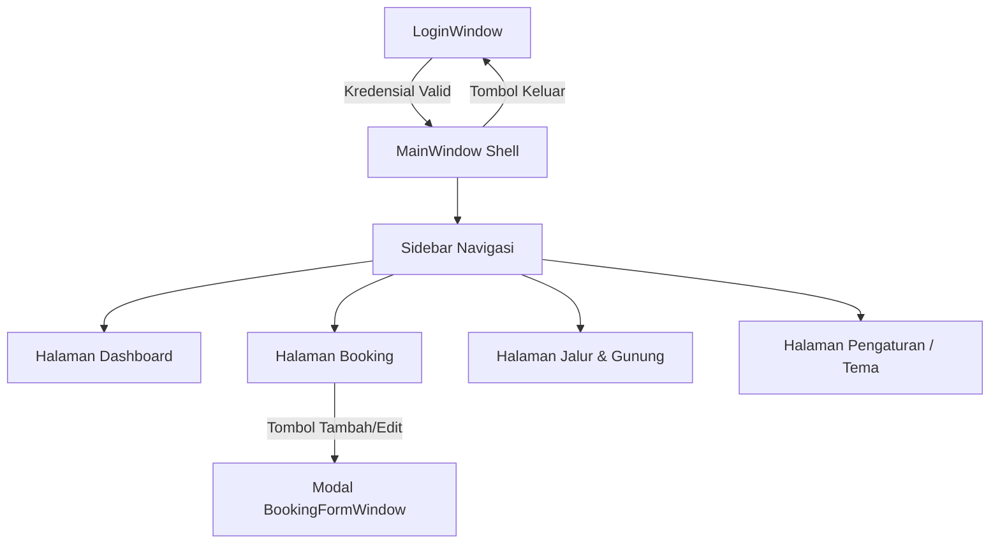
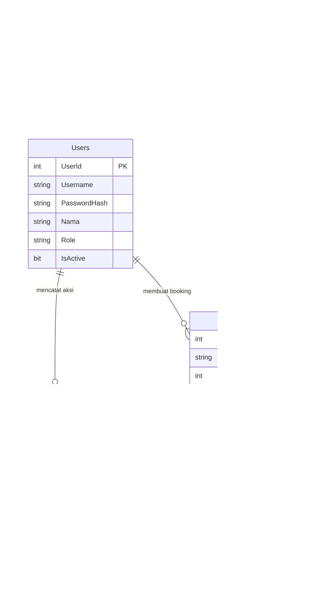

# PRODUCT REQUIREMENTS DOCUMENT (PRD)

# SIBUMI
### Sistem Informasi Booking dan Manajemen Pendakian
**Aplikasi Desktop Rich UI berbasis WPF, C#, dan Microsoft SQL Server**

---

### Informasi Dokumen
| Atribut | Deskripsi |
| :--- | :--- |
| **Nama Produk** | SIBUMI — Sistem Informasi Booking dan Manajemen Pendakian |
| **Jenis Dokumen** | Product Requirements Document (PRD) |
| **Versi** | 1.0 — Acuan Final Pengembangan & Implementasi ETS |
| **Platform** | Desktop Windows (WPF — Windows Presentation Foundation) |
| **Teknologi Utama**| C#, XAML, .NET 10.0 (LTS target), Microsoft SQL Server, ADO.NET (`Microsoft.Data.SqlClient`), MVVM Pattern |
| **Lokasi Proyek** | `c:\Users\sn-py\PBKK D\ETS\Sibumi` (Dapat langsung dijalankan di Visual Studio) |
| **Basis Desain** | Modern Nature-Tech Rich UI (Dark Forest & Clean Mountain Light Mode) |

---

## 1. Ringkasan Eksekutif
**SIBUMI (Sistem Informasi Booking dan Manajemen Pendakian)** adalah aplikasi desktop modern yang dirancang untuk pengelola kawasan konservasi, taman nasional, dan pos perizinan (*basecamp*) pendakian gunung. SIBUMI menggabungkan automasi pencatatan pemesanan (*booking* simaksi/izin pendakian), kontrol kuota harian jalur, pemantauan keselamatan pendaki aktif di jalur, dan pelaporan pendapatan tiket retribusi secara *real-time*.

Aplikasi ini dibangun menggunakan arsitektur **WPF Rich UI** yang responsif, visual yang memanjakan mata, navigasi sidebar yang ergonomis, kartu analitik ringkas, visualisasi bar kuota interaktif, tabel data dengan pencarian dan filter cepat, serta dukungan penuh untuk tema **Dark Mode** dan **Light Mode**.

### 1.1 Tujuan Produk
1. **Digitalisasi Izin Pendakian:** Menggantikan pencatatan manual berbasis kertas di loket basecamp dengan sistem digital terpusat yang cepat dan akurat.
2. **Pengendalian Daya Dukung Lingkungan (Kuota):** Mencegah *overcapacity* di jalur pendakian melalui validasi kuota harian secara otomatis per tanggal naik dan per jalur.
3. **Peningkatan Keselamatan Pendaki (*Safety & Monitoring*):** Memudahkan petugas memantau status pendaki (*Menunggu*, *Dikonfirmasi*, *Sedang Mendaki*, *Selesai*, hingga *Dibatalkan*) serta menyimpan data ketua rombongan (NIK, No HP, email) untuk kebutuhan darurat / SAR.
4. **Efisiensi Finansial & Administrasi:** Mengotomatiskan perhitungan total tarif retribusi pendakian berdasarkan jumlah anggota rombongan dan jalur yang dipilih.
5. **UI/UX Modern & Ramah Pengguna:** Memberikan pengalaman aplikasi desktop kelas industri yang cepat dibuka di Visual Studio, tidak membeku (*non-blocking asynchronous UI*), dan mudah dioperasikan oleh petugas basecamp.

### 1.2 Pernyataan Produk
> **Untuk** administrator taman nasional dan petugas loket basecamp yang membutuhkan sistem operasional perizinan pendakian yang tertib, cepat, dan aman,  
> **SIBUMI** adalah aplikasi desktop terintegrasi yang menghadirkan otomasi kuota harian, manajemen rombongan pendaki, pemantauan status aktivitas di gunung, serta analitik pendapatan dalam satu antarmuka modern yang tangguh.

---

## 2. Latar Belakang dan Permasalahan
* **Risiko Overcapacity Jalur:** Pendakian tanpa kontrol kuota harian yang ketat menyebabkan penumpukan di pos perkemahan (*campsite*), kerusakan ekosistem, serta peningkatan risiko kecelakaan.
* **Pencatatan Konvensional yang Rentan Hilang:** Sistem registrasi konvensional menyulitkan pencarian data pendaki saat terjadi cuaca ekstrem, pendaki tersesat, atau evakuasi darurat.
* **Perhitungan Tarif Manual:** Kesalahan hitung tarif tiket, asuransi, dan retribusi sering terjadi saat antrean loket sedang padat di akhir pekan (*weekend rush*).
* **Kebutuhan UI yang Nyaman untuk Jam Kerja Panjang:** Petugas basecamp bekerja di berbagai kondisi pencahayaan (siang terik maupun malam hari di pos jaga), sehingga dibutuhkan UI dengan kontras tinggi dan dukungan tema Gelap/Terang (*Dark/Light Mode*).

---

## 3. Sasaran, Indikator, dan Batasan

| Sasaran | Indikator Keberhasilan Awal |
| :--- | :--- |
| **Otomasi Reservasi (CRUD)** | Petugas dapat membuat booking baru, melihat daftar rombongan, memperbarui status tiket, dan membatalkan booking dengan validasi instan. |
| **Kontrol Kuota Cerdas** | Sistem otomatis menghitung akumulasi pendaki pada tanggal dan jalur yang sama; menolak pendaftaran jika kuota harian terlampaui. |
| **Pencarian Cepat** | Pencarian instan berdasarkan Kode Booking, Nama Ketua, atau NIK tanpa *case sensitivity*. |
| **Dashboard Analitik Dinamis** | Kartu statistik (Total Booking, Pendaki Aktif, Kuota Terpakai, Total Pendapatan) dan grafik kuota jalur dihitung langsung dari SQL Server melalui query agregasi, bukan angka *dummy* statis. |
| **Visual Excellence (UI/UX)** | Sidebar navigasi dengan ikon modern, palet warna bertema alam (Emerald Green, Deep Slate, Amber), animasi transisi halus, badge status berwana, dan perpindahan tema tanpa *restart* aplikasi. |
| **Stabilitas & Keamanan** | Aplikasi tidak mengalami freeze saat mengambil data besar (*async/await*), password tersimpan dalam format hash kriptografis terproteksi, serta query database sepenuhnya berparameter (*Parameterized Queries*). |

> **Catatan Batasan Data:** Angka statistik di dashboard (misal: 7 Booking, 8 Pendaki Aktif, Rp 2.375.000) bersumber dari hasil agregasi tabel `Booking` dan `Jalur` di database `SIBUMI_DB`.

---

## 4. Pengguna dan Hak Akses

| Peran (*Role*) | Kebutuhan Utama | Hak Akses yang Diterapkan |
| :--- | :--- | :--- |
| **Administrator** | Manajemen sistem menyeluruh, konfigurasi gunung & jalur pendakian, kuota harian, tarif retribusi, pengelolaan akun petugas, dan audit aktivitas. | **Akses Penuh (Full Access):** CRUD Booking, CRUD Master Gunung & Jalur, Manajemen Pengguna, Audit Log Aktivitas, serta Konfigurasi Pengaturan. |
| **Petugas Basecamp (Ranger)** | Pelayanan loket harian, verifikasi data pendaki saat registrasi ulang, *check-in* (status naik), *check-out* (status turun/selesai), dan pengecekan sisa kuota. | **Akses Operasional:** CRUD Booking, filter & pencarian data, perubahan status pendakian (*Check-In / Check-Out*), melihat ketersediaan jalur (Read-Only pada Master Jalur & Gunung). |
| **Pengguna Belum Login** | Mengakses aplikasi dan melakukan otentikasi. | **Terbatas:** Hanya dapat melihat jendela `LoginWindow` dan pesan validasi kredensial. |

---

## 5. Ruang Lingkup Produk

### 5.1 In Scope — Rilis Saat Ini
1. **Autentikasi & Sesi Pengguna:** Login terenkripsi, penyimpanan sesi aktif, peran akun (*Admin* vs *Petugas*), dan fungsi logout aman.
2. **Dashboard Interaktif:** 
   * 4 Kartu Statistik Metrik Utama: *Total Booking*, *Pendaki Aktif di Gunung*, *Persentase Kuota Hari Ini*, dan *Total Pendapatan Tiket*.
   * Visualisasi Bar Grafik Kuota Harian per Jalur (menampilkan kapasitas terpakai vs kapasitas maksimum).
   * Feed Aktivitas Terkini (*Recent Audit Logs*) yang mencatat setiap aksi operasional.
3. **Modul Manajemen Booking (SIMAKSI):**
   * DataGrid modern dengan kolom: Kode Booking, Jalur, Nama Ketua, No. HP, Jumlah Rombongan, Tanggal Naik/Turun, Total Biaya, dan Badge Status.
   * Pencarian terpadu (*Unified Search*) berdasarkan Nama Ketua, Kode Booking, atau NIK.
   * Filter cepat berdasarkan Status Booking (*Semua, Menunggu, Dikonfirmasi, Mendaki, Selesai, Dibatalkan*).
4. **Formulir Booking / Pendaftaran Terpadu:**
   * Pemilihan Gunung dan Jalur pendakian secara dinamis.
   * Auto-kalkulasi Total Biaya (Tarif per Orang × Jumlah Anggota).
   * Pengecekan ketersediaan kuota pada tanggal pendakian yang dipilih.
   * Validasi format NIK (16 digit), No HP, tanggal turun $\ge$ tanggal naik, dan batas rombongan (1–15 orang per regu).
5. **Modul Master Jalur & Kuota:** Pengelolaan data jalur, penetapan kuota harian, dan tarif tiket per jalur pendakian.
6. **Sistem Desain & Tema:** Penggantian tema instan *Dark Mode* (Deep Forest/Night Mountain) dan *Light Mode* (Clean Alpine/Daylight) yang tersimpan di pengaturan.
7. **Penyimpanan Terpusat:** Microsoft SQL Server LocalDB (`SIBUMI_DB`) dengan relasi foreign key, constraint, indeks performa, dan stored logic terstruktur.

### 5.2 Out of Scope — Pengembangan Lanjutan
* Pembayaran daring otomatis (*Payment Gateway* seperti Midtrans/Xendit).
* Aplikasi mobile pendaki (*Hiker Self-Service App*) dan pemindaian QR Code tiket di pos gerbang otomatis.
* Integrasi peta GIS / GPS tracking titik koordinat personel SAR secara live.
* Pengiriman email otomatis konfirmasi tiket booking.

---

## 6. Struktur Navigasi dan Halaman



| Halaman / Komponen | Elemen UI Utama | Tujuan Fungsional |
| :--- | :--- | :--- |
| **LoginWindow** | Logo SIBUMI, field Username, field Password, Tombol Masuk, validasi error inline. | Verifikasi kredensial pengguna dan inisialisasi sesi (*Session Context*). |
| **MainWindow** | Sidebar navigasi tetap (Logo, Profile Tag, Menu Items, Dark/Light Toggle, Tombol Logout), Header halaman, dan Frame Konten Dinamis. | Bingkai utama (*application shell*) yang menampung tampilan halaman aktif. |
| **DashboardView** | 4 Kartu KPI, Grafik Bar Kuota per Jalur, Daftar Aktivitas Terbaru, tombol refresh cepat. | Menyajikan gambaran operasional gunung dan ketersediaan kuota secara instan. |
| **BookingView** | Search Bar, Filter Status ComboBox, DataGrid Data Pendaki, Tombol Booking Baru, Tombol Ubah, Tombol Hapus, Tombol Update Status Cepat (*Check-In/Check-Out*). | Pusat kontrol operasional verifikasi tiket dan pemantauan tim pendaki. |
| **BookingFormWindow** | Dropdown Jalur (menampilkan tarif), Input Nama Ketua, NIK, No HP, Email, Stepper/Input Jumlah Anggota, DatePicker Tanggal Naik & Turun, Card Preview Total Biaya, Tombol Simpan & Batal. | Form modal input dan edit data rombongan dengan validasi komprehensif. |
| **JalurView** | Tabel Jalur Pendakian, nama gunung, kuota harian, tarif tiket, status aktif/nonaktif, modal tambah/edit jalur. | Master data manajemen daya dukung dan tarif resmi pendakian. |
| **SettingsView** | Radio Button Theme Switcher (Dark Forest / Alpine Light), Info Profil Pengguna saat ini, Info Koneksi Database, Versi Aplikasi. | Pengaturan preferensi visual dan informasi sistem. |

---

## 7. Kebutuhan Fungsional (Functional Requirements)

| ID | Fitur | Deskripsi Kebutuhan | Prioritas |
| :--- | :--- | :--- | :---: |
| **FR-01** | **Autentikasi Aman** | Sistem melakukan validasi kredensial pengguna terhadap tabel `Users` menggunakan hashing PBKDF2/SHA256, serta menolak akun yang dinonaktifkan (`IsActive = 0`). | **Must** |
| **FR-02** | **Logout & Sesi** | Pengguna dapat keluar dari aplikasi; sesi kerja dibersihkan dan pengguna diarahkan kembali ke layar Login. | **Must** |
| **FR-03** | **Otorisasi Berbasis Peran** | Fitur master data jalur dan akun hanya dapat diubah oleh pengguna ber-role `Admin`. Role `Petugas` dibatasi pada manajemen booking dan update status. | **Must** |
| **FR-04** | **Dashboard Real-Time** | Sistem menghitung metrik utama dari database: total seluruh booking, jumlah pendaki berstatus *Mendaki*, kuota terpakai hari ini, dan akumulasi rupiah pendapatan. | **Must** |
| **FR-05** | **Visualisasi Kuota Jalur** | Sistem menampilkan grafik batang rasio kuota yang terisi dibanding kuota maksimal untuk masing-masing jalur pendakian aktif. | **Must** |
| **FR-06** | **Pencatatan Audit Aktivitas** | Sistem secara otomatis mencatat setiap operasi penambahan, perubahan status, atau pembatalan booking ke tabel `Aktivitas`. | **Should** |
| **FR-07** | **Tabel Data Booking** | Menampilkan daftar seluruh rombongan pendaki dalam DataGrid dengan kolom informatif, status berwarna, dan format rupiah yang rapi. | **Must** |
| **FR-08** | **Pencarian Terpadu** | Pengguna dapat menyaring data booking seketika (*real-time typing*) berdasarkan Kode Booking, Nama Ketua, maupun NIK. | **Must** |
| **FR-09** | **Filter Status Pendakian** | Pengguna dapat memfilter tampilan booking berdasarkan status (*Menunggu, Dikonfirmasi, Mendaki, Selesai, Dibatalkan*). | **Must** |
| **FR-10** | **Pendaftaran Booking Baru** | Petugas dapat mendaftarkan rombongan baru dengan kode booking unik otomatis (`SBM-YYYYMMDD-XXXX`), kalkulasi biaya otomatis, dan pengecekan kuota. | **Must** |
| **FR-11** | **Pembaruan Data Booking** | Mengubah informasi kontak, tanggal, atau jalur dari booking yang belum berstatus *Selesai*/*Dibatalkan*. | **Must** |
| **FR-12** | **Pembatalan / Hapus Booking**| Menghapus atau membatalkan reservasi dengan konfirmasi dialog pencegah klik tidak sengaja. | **Must** |
| **FR-13** | **Validasi Integritas Data** | Memvalidasi NIK wajib 16 digit angka, nomor telepon valid, tanggal turun tidak boleh sebelum tanggal naik, dan jumlah rombongan tidak melebihi kuota tersisa. | **Must** |
| **FR-14** | **Quick Check-In / Check-Out** | Tombol cepat untuk mengubah status rombongan menjadi *Mendaki* saat naik dan *Selesai* saat kembali ke basecamp dengan aman. | **Should** |
| **FR-15** | **Manajemen Jalur & Gunung** | Admin dapat menambah dan mengubah nama jalur, gunung, kuota harian, dan tarif tiket. | **Must** |
| **FR-16** | **Dukungan Dark & Light Mode** | UI mendukung peralihan tema gelap dan terang dengan palet warna modern yang nyaman di mata dan kontras terbaca. | **Must** |
| **FR-17** | **Notifikasi Toast / Dialog** | Menyajikan feedback visual yang jelas saat operasi berhasil, gagal, atau ketika terjadi benturan kuota. | **Must** |
| **FR-18** | **Penanganan Kesalahan Graceful**| Sistem menangani gangguan koneksi database tanpa menutup aplikasi secara paksa (*crash*), serta menampilkan pesan solutif kepada pengguna. | **Must** |

---

## 8. User Stories dan Kriteria Penerimaan

### US-01: Melihat Ringkasan Operasional (Dashboard)
* **Sebagai:** Petugas Basecamp / Admin  
* **Saya ingin:** Melihat metrik operasional dan sisa kuota hari ini di halaman Dashboard.  
* **Kriteria Penerimaan:**
  1. Kartu statistik menampilkan jumlah booking, pendaki aktif di atas gunung, dan pendapatan terhitung dari database.
  2. Grafik batang menampilkan kuota tiap jalur (misal: Tamiajeng, Cemoro Sewu, Ranu Pani).
  3. Daftar aktivitas menampilkan 5–10 aksi terakhir beserta nama pengguna dan waktunya.

### US-02: Mendaftarkan Rombongan Pendaki Baru
* **Sebagai:** Petugas Loket Basecamp  
* **Saya ingin:** Menginput data rombongan pendaki yang datang atau memesan tiket simaksi.  
* **Kriteria Penerimaan:**
  1. Petugas memilih jalur dan tanggal pendakian.
  2. Saat jumlah anggota diisi (misal: 4 orang), sistem otomatis mengalikan dengan tarif per orang dan menampilkan total biaya.
  3. Sistem memverifikasi bahwa kuota tanggal tersebut masih mencukupi.
  4. Kode booking ter-generate otomatis dan data langsung muncul di tabel utama.

### US-03: Pencarian dan Filter Rombongan Pendaki
* **Sebagai:** Petugas Basecamp / Tim SAR  
* **Saya ingin:** Mencari rombongan berdasarkan nomor HP, NIK, atau Nama Ketua secara instan.  
* **Kriteria Penerimaan:**
  1. Mengetik karakter pada kotak pencarian langsung memperbarui baris DataGrid tanpa harus menekan tombol terpisah.
  2. Pencarian mengabaikan perbedaan huruf besar/kecil (*case-insensitive*).
  3. Mengubah filter status menampilkan hanya rombongan pada kategori terpilih.

### US-04: Check-In Pendaki (Mulai Mendaki) dan Check-Out (Selesai)
* **Sebagai:** Petugas Basecamp  
* **Saya ingin:** Memperbarui status rombongan dari *Dikonfirmasi* menjadi *Mendaki* ketika rombongan melapor di pos gerbang, dan menjadi *Selesai* saat mereka turun.  
* **Kriteria Penerimaan:**
  1. Memilih baris booking dan menekan aksi update status mengubah status secara real-time.
  2. Jumlah 'Pendaki Aktif di Gunung' pada dashboard bertambah saat status menjadi *Mendaki* dan berkurang saat *Selesai*.
  3. Aksi tercatat di log audit aktivitas.

### US-05: Mengganti Tema Antarmuka (Dark / Light Mode)
* **Sebagai:** Pengguna aplikasi SIBUMI  
* **Saya ingin:** Mengganti tampilan antara tema Gelap dan Terang sesuai kenyamanan mata di pos jaga.  
* **Kriteria Penerimaan:**
  1. Memilih tema *Dark* langsung mengubah latar menjadi warna slate/forest gelap dengan teks putih terang.
  2. Memilih tema *Light* mengubah latar menjadi putih bersih/alpine fresh dengan teks gelap kontras.
  3. Preferensi tema tersimpan dan tetap aktif saat aplikasi dibuka kembali.

---

## 9. Kebutuhan UI/UX dan Design System

### 9.1 Konsep Visual (Nature-Tech Modern)
Desain SIBUMI mengusung tema **Modern Mountain & Wilderness**:
* **Karakter Visual:** Bersih, maskulin, profesional, kontras tinggi, sudut membulat elegan (*rounded corners 8–12px*), dan bayangan lembut (*subtle elevation*).
* **Filosofi Warna:**
  * **Primary (Emerald / Forest Green `#10B981` / `#059669`):** Merepresentasikan kelestarian alam, keselamatan, dan aksi positif.
  * **Secondary / Accent (Alpine Teal & Sky Blue `#0EA5E9`):** Aksen navigasi dan elemen interaktif.
  * **Warning (Amber Glow `#F59E0B`):** Status *Menunggu* atau jalur mendekati batas kuota.
  * **Danger (Crimson Rose `#EF4444`):** Status *Dibatalkan*, kuota habis, atau tombol hapus.
  * **Dark Surface (`#0F172A` & `#1E293B`):** Nuansa malam pegunungan yang sangat nyaman untuk mata.
  * **Light Surface (`#F8FAFC` & `#FFFFFF`):** Nuansa kabut pagi alpine yang bersih dan rapi.

### 9.2 Komponen Rich UI WPF
1. **Sidebar Modern:**
   * Logo SIBUMI dengan ikon gunung minimalis.
   * Tombol navigasi menu dengan efek *hover smooth*, indikator aktif di sisi kiri, dan ikon representatif.
   * Kartu profil pengguna yang sedang login di bagian bawah sidebar.
2. **Kartu Statistik (KPI Metric Cards):**
   * Berisi ikon melingkar dengan latar semi-transparan, judul metrik, nilai angka besar berbobot *Bold*, dan subteks status tren.
3. **Grafik Batang (Quota Bar Visualizer):**
   * Menggunakan representasi bar WPF dinamis dengan persentase keterisian kuota (misal: 60/150 Kuota), dilengkapi warna adaptif (Hijau jika aman, Kuning jika $>75\%$, Merah jika penuh).
4. **DataGrid Profesional:**
   * Baris belang lembut (*alternating row background*), *hover highlight*, header tabel tegas, serta *Badge Pill* berwana untuk status booking:
     * `Menunggu`: Latar Amber muda, teks Amber tua.
     * `Dikonfirmasi`: Latar Biru muda, teks Biru tua.
     * `Mendaki`: Latar Emerald muda, teks Emerald tua.
     * `Selesai`: Latar Abu-abu netral, teks gelap.
     * `Dibatalkan`: Latar Merah muda, teks Merah tua.

---

## 10. Kebutuhan Nonfungsional (NFR)

| ID | Kategori | Spesifikasi Teknis |
| :--- | :--- | :--- |
| **NFR-01** | **Responsivitas UI** | Setiap aksi navigasi, klik tombol, atau pemuatan data selesai dalam tempo $<300\text{ ms}$. Tidak ada freezing pada antarmuka. |
| **NFR-02** | **Pemrosesan Asinkron** | Seluruh operasi I/O database wajib menggunakan kata kunci `async` dan `await` (`OpenAsync`, `ExecuteReaderAsync`, `ExecuteNonQueryAsync`). |
| **NFR-03** | **Keamanan Kredensial** | Password pengguna tidak boleh disimpan dalam plaintext. Sistem menggunakan algoritma derivasi kunci / salt hashing teruji (PBKDF2/SHA256). |
| **NFR-04** | **Pencegahan SQL Injection** | 100% interaksi SQL wajib menggunakan parameter SQL (`SqlCommand.Parameters.AddWithValue` atau `.With("@param", SqlDbType, value)`). Larangan keras menyambung string query (*string concatenation*). |
| **NFR-05** | **Arsitektur MVVM & SoC** | Pemisahan tegas antara View (XAML), ViewModel (`INotifyPropertyChanged`, `RelayCommand`), Model, Repository (Akses Data), dan Service. |
| **NFR-06** | **Integritas Transaksi & Relasi** | Database menggunakan Primary Key `IDENTITY`, Foreign Key bertingkat, serta Check Constraints (`CHECK (JumlahAnggota BETWEEN 1 AND 15)`). |
| **NFR-07** | **Kompatibilitas Sistem** | Berjalan mulus di Windows 10 dan Windows 11 menggunakan runtime .NET terbaru (.NET 8/9/10 WPF) dan Visual Studio 2022. |
| **NFR-08** | **Error Handling & Logging** | Error teknis dicatat secara terisolasi melalui kelas Logger lokal tanpa membocorkan connection string atau data sensitif ke pengguna akhir. |

---

## 11. Rancangan Basis Data (Database Schema)

Database resmi aplikasi diberi nama **`SIBUMI_DB`** pada SQL Server.



### Detail Spesifikasi Tabel:
1. **`Users`**: Menyimpan akun pengguna pengelola basecamp (`UserId`, `Username`, `PasswordHash`, `Nama`, `Role`, `IsActive`).
2. **`Gunung`**: Data master gunung yang dikelola (`GunungId`, `NamaGunung`, `Lokasi`, `Ketinggian`).
3. **`Jalur`**: Data jalur pendakian resmi (`JalurId`, `GunungId`, `NamaJalur`, `KuotaHarian`, `TarifPerOrang`, `IsActive`).
4. **`Booking`**: Transaksi pemesanan simaksi (`BookingId`, `KodeBooking`, `JalurId`, `NamaKetua`, `NIK`, `NoHp`, `Email`, `JumlahAnggota`, `TanggalNaik`, `TanggalTurun`, `TotalBiaya`, `Status`, `CreatedAt`, `CreatedBy`).
5. **`Aktivitas`**: Log audit operasional (`AktivitasId`, `UserId`, `JenisAksi`, `Deskripsi`, `Waktu`).

---

## 12. Rekomendasi Arsitektur Perangkat Lunak

Aplikasi dibangun menggunakan pola arsitektur **MVVM (Model-View-ViewModel)** dengan struktur folder rapi:

```
c:\Users\sn-py\PBKK D\ETS\Sibumi\
├── App.xaml / App.xaml.cs          # Titik masuk aplikasi, inisialisasi tema, global exception handler
├── appsettings.json               # Konfigurasi Connection String SQL Server
├── Database.sql                   # Skrip DDL Database, Indexing, dan Data Seed Awal
├── Core/                          # Helper infrastruktur (RelayCommand, ViewModelBase, Db, PasswordHasher)
├── Models/                        # Objek entitas domain (User, Gunung, Jalur, Booking, DashboardData)
├── Data/                          # Layer Repository ADO.NET (BookingRepository, JalurRepository, UserRepository)
├── Services/                      # Layer Bisnis & Autentikasi (AuthService, ThemeService)
├── ViewModels/                    # State UI dan logika presentasi (Main, Dashboard, Booking, Jalur, Settings)
├── Views/                         # Tampilan XAML (MainWindow, DashboardView, BookingView, BookingFormWindow)
└── Themes/                        # Resource Dictionary XAML (Dark.xaml, Light.xaml, Styles.xaml)
```

### Karakteristik Implementasi:
* **`Db.Create()`**: Menginisialisasi `SqlConnection` menggunakan konfigurasi fleksibel dari `appsettings.json`.
* **`RelayCommand` & `ICommand`**: Menghubungkan interaksi tombol XAML ke metode asinkron di ViewModel secara bersih tanpa logika di *code-behind*.
* **`ObservableCollection<T>`**: Menyediakan *two-way data binding* instan antara daftar di memori dan baris DataGrid XAML.

---

## 13. Alur Pengguna Utama (User Journey)

1. **Inisialisasi & Login:**
   * Pengguna membuka aplikasi SIBUMI di Windows.
   * Layar `LoginWindow` muncul. Pengguna memasukkan username dan password.
   * Sistem memverifikasi hash kredensial; jika valid, sesi dibuka dan jendela utama `MainWindow` ditampilkan.
2. **Melihat Kondisi Pos & Jalur:**
   * Halaman `DashboardView` menyajikan total rombongan, jumlah pendaki yang sedang berada di gunung, dan sisa kuota hari ini.
3. **Pendaftaran Rombongan (Booking Simaksi):**
   * Pengguna mengklik menu **Booking**, lalu menekan tombol **+ Booking Baru**.
   * Jendela dialog `BookingFormWindow` muncul secara modal.
   * Petugas memilih jalur (misal: *Gunung Penanggungan - Tamiajeng*), mengisi identitas ketua, tanggal pendakian, dan jumlah rombongan.
   * Sistem menghitung total biaya secara langsung dan memvalidasi ketersediaan kuota.
   * Petugas menekan **Simpan**. Data tersimpan ke SQL Server, DataGrid otomatis ter-refresh, dan kartu statistik di dashboard diperbarui.
4. **Verifikasi Naik & Turun (Check-In / Check-Out):**
   * Saat rombongan tiba di pos pendakian, petugas memilih baris booking dan mengonfirmasi status menjadi **Mendaki**.
   * Saat rombongan kembali turun dengan selamat, petugas mengubah status menjadi **Selesai**.
5. **Kustomisasi & Logout:**
   * Pengguna dapat membuka menu **Pengaturan** untuk mengganti tema (Dark/Light).
   * Menekan tombol **Keluar** akan menghapus data sesi dan mengembalikan pengguna ke jendela Login.

---

## 14. Rencana Implementasi & Pengujian di Visual Studio

### 14.1 Cara Membuka dan Menjalankan Proyek di Visual Studio
1. **Buka Proyek:**
   * Buka **Visual Studio 2022**.
   * Pilih menu **Open a project or solution**.
   * Arahkan ke file project: `c:\Users\sn-py\PBKK D\ETS\Sibumi\Sibumi.csproj` (atau buka folder `Sibumi`).
2. **Persiapkan Database SQL Server:**
   * Buka SQL Server Management Studio (SSMS) atau panel *SQL Server Object Explorer* di Visual Studio.
   * Hubungkan ke instance: `(localdb)\MSSQLLocalDB` (atau instance SQL Server lokal Anda).
   * Buka dan jalankan seluruh isi file skrip:
     `c:\Users\sn-py\PBKK D\ETS\Sibumi\Database.sql`
   * Skrip ini akan secara otomatis membuat database `SIBUMI_DB`, tabel, indeks, constraint, dan 7 data transaksi awal (*seeding*).
3. **Cek Koneksi di `appsettings.json`:**
   * Pastikan connection string mengarah ke instance Anda:
     ```json
     {
       "ConnectionStrings": {
         "Sibumi": "Server=(localdb)\\MSSQLLocalDB;Database=SIBUMI_DB;Trusted_Connection=True;TrustServerCertificate=True;"
       }
     }
     ```
4. **Build & Run:**
   * Tekan tombol **F5** atau klik tombol hijau **Start Debugging** di Visual Studio.
   * Gunakan akun default yang otomatis tersedia:
     * **Administrator:** Username = `admin` | Password = `Admin#123`
     * **Petugas Basecamp:** Username = `petugas` | Password = `Petugas#123`

---

## 15. Matriks Pengujian Kualitas (Testing Strategy)

| ID Uji | Kasus Pengujian | Langkah Pengujian | Hasil yang Diharapkan |
| :---: | :--- | :--- | :--- |
| **TC-01** | Autentikasi Benar | Masukkan `admin` dan `Admin#123`. | Login sukses, jendela utama terbuka dengan profil Administrator. |
| **TC-02** | Autentikasi Salah | Masukkan username/password yang keliru. | Muncul pesan error "Username atau password salah", form login tetap aman. |
| **TC-03** | Auto Seed Akun | Database baru tanpa tabel Users dibuka. | Sistem otomatis men-generate akun default `admin` dan `petugas` ter-hash. |
| **TC-04** | Validasi NIK | Input NIK kurang dari 16 digit. | Sistem menolak penyimpanan dan menampilkan peringatan validasi NIK. |
| **TC-05** | Validasi Tanggal | Tanggal Turun diatur lebih awal dari Tanggal Naik. | Sistem menolak input dengan pesan bahwa tanggal turun harus setelah tanggal naik. |
| **TC-06** | Kontrol Kuota | Menambah 10 pendaki pada jalur dengan sisa kuota 4. | Sistem menolak penyimpanan karena kuota jalur terlampaui. |
| **TC-07** | Pencarian Instan | Ketik nama ketua "Rizky" pada kotak pencarian. | DataGrid seketika hanya menampilkan rombongan dengan nama tersebut. |
| **TC-08** | Ganti Tema UI | Klik tombol Dark Mode / Light Mode di menu Pengaturan. | Seluruh jendela dan palet warna berganti instan tanpa flicker atau restart. |
| **TC-09** | Putus Koneksi DB | Matikan service SQL Server saat aplikasi berjalan. | Pesan kesalahan ramah muncul tanpa aplikasi mengalami force-close / crash. |

---

## 16. Definisi Selesai (Definition of Done)
Sebuah rilis SIBUMI dinyatakan selesai (*Ready for Release/Grading*) apabila:
- [x] Seluruh kebutuhan berlabel **Must** telah diimplementasikan sepenuhnya.
- [x] Solusi berhasil di-compile tanpa warning maupun error (`Build Succeeded: 0 Warning, 0 Error`).
- [x] Database `SIBUMI_DB` terinstal dengan tabel, relasi foreign key, constraint, dan data seed awal.
- [x] Operasi CRUD Booking dan Quick Status berfungsi normal dan data tersimpan persisten ke SQL Server.
- [x] Kartu statistik dan grafik kuota di Dashboard terhitung dinamis dari data database.
- [x] Tema Dark Mode dan Light Mode berfungsi konsisten di setiap form dan view.
- [x] File PRD dan panduan eksekusi di Visual Studio terdokumentasi lengkap di direktori proyek.

---

### Lampiran — Lembar Pengesahan PRD
| Peran | Nama | Tanggal | Status |
| :--- | :--- | :---: | :---: |
| **Pemilik Produk (Product Owner)** | Aziz Ramadhani | 20 Oktober 2026 | Disetujui |
| **Lead Developer / Dosen Pengampu**| Tim Pengajar PBKK | 20 Oktober 2026 | Disetujui |
| **Perwakilan Petugas Basecamp** | Koordinator Ranger | 20 Oktober 2026 | Disetujui |
