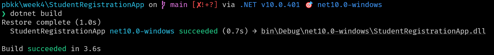
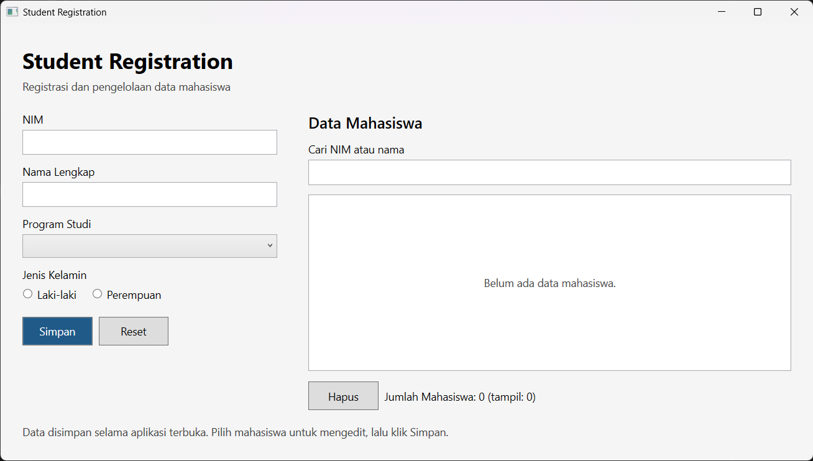
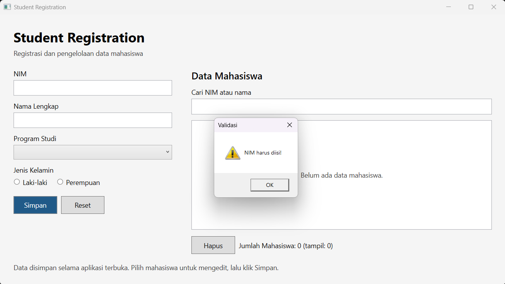
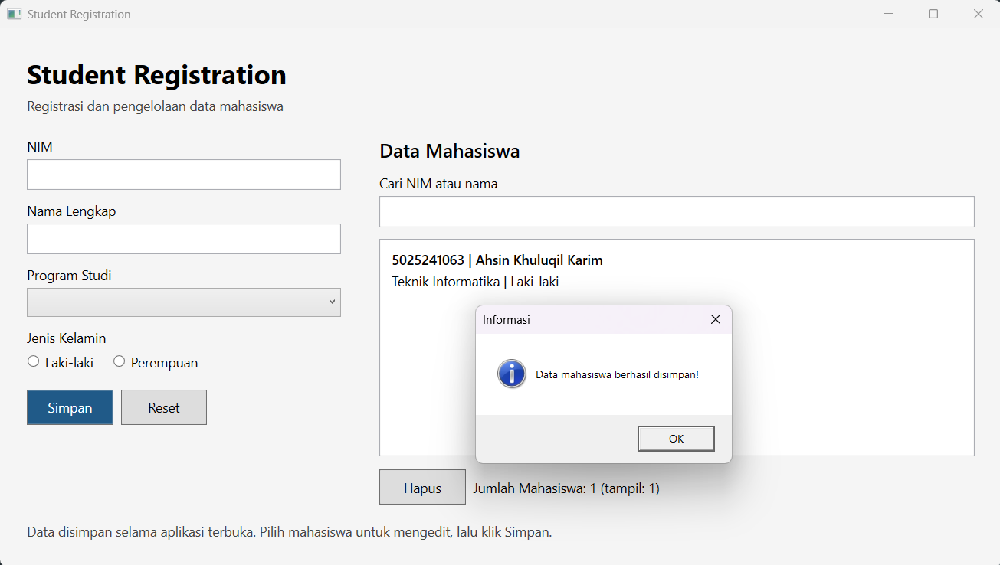
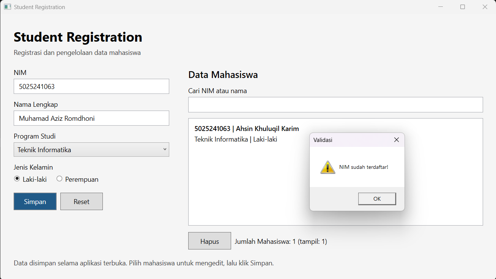
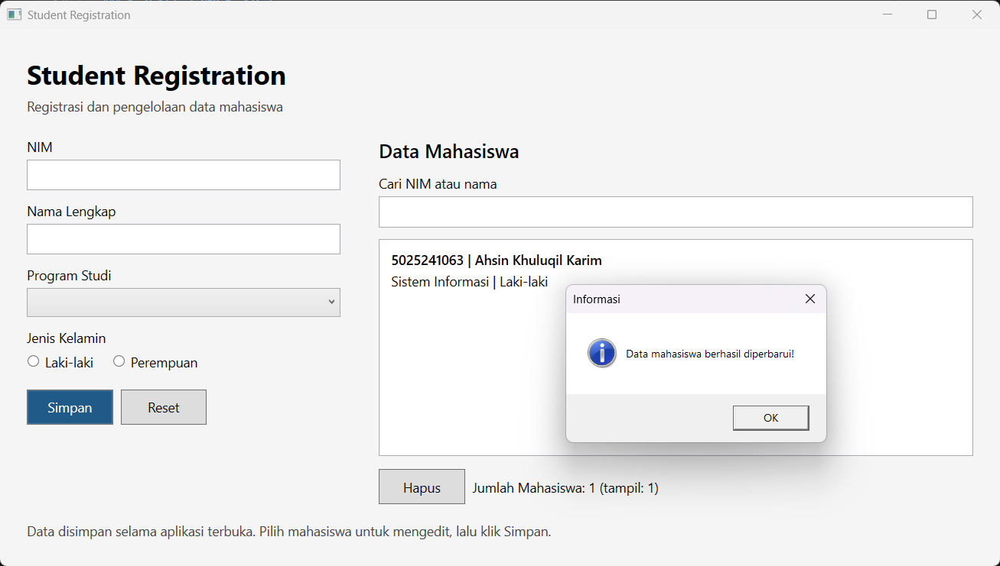
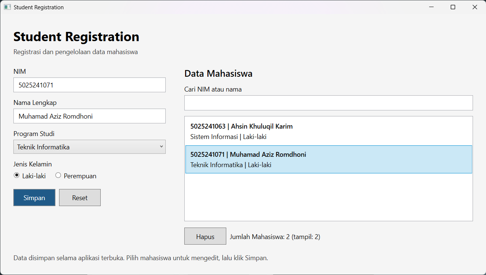
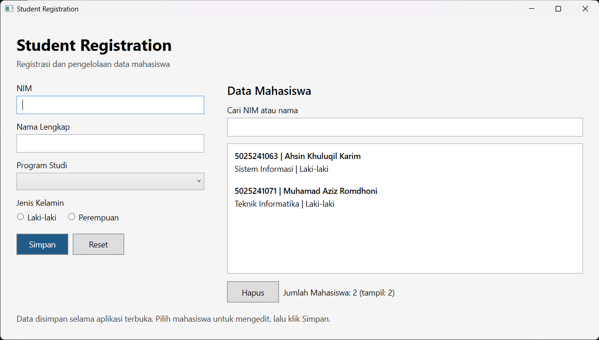
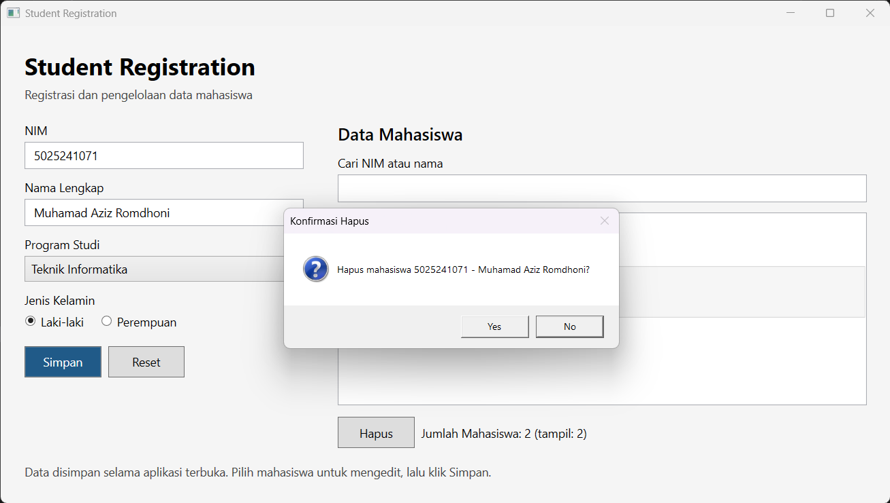
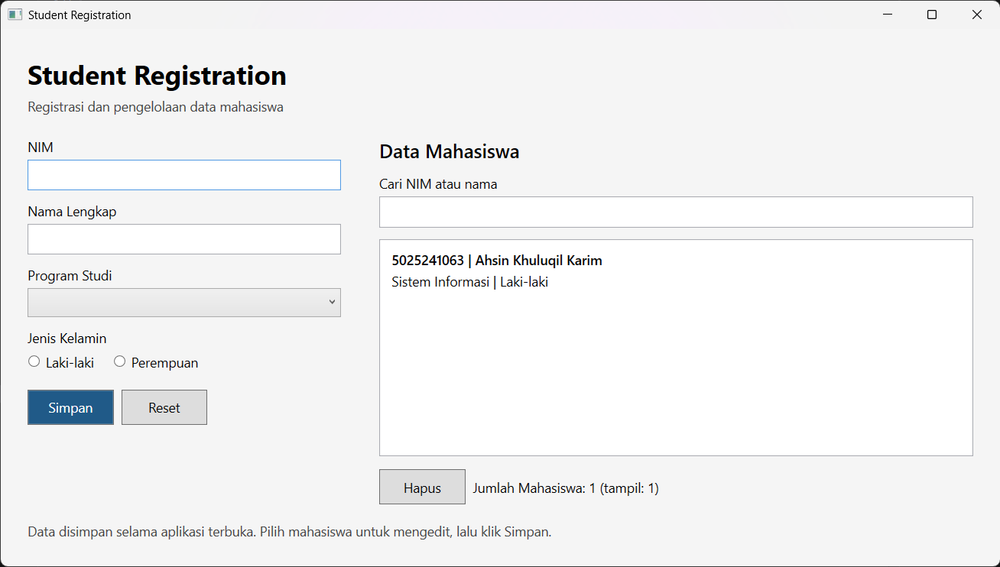

# StudentRegistrationApp

Aplikasi desktop **WPF (.NET 10)** untuk registrasi mahasiswa. Proyek week 4 ini mengikuti langkah praktikum **Student Registration App** pada **HOL1.pdf**. Form utama berisi NIM, nama mahasiswa, program studi, dan jenis kelamin. Data mahasiswa hanya terdiri dari empat field tersebut. Fitur pengelolaan meliputi edit, pencarian, konfirmasi hapus, dan penghitung mahasiswa.

---

## Penjelasan Program

Pengguna mengisi NIM, nama, program studi, dan jenis kelamin. Data ditampilkan dalam ListBox. Mahasiswa yang dipilih dapat diedit melalui form yang sama. Aplikasi menyediakan pencarian NIM/nama, reset, konfirmasi hapus, dan penghitung jumlah mahasiswa.

Data disimpan di memori selama aplikasi terbuka. Menutup aplikasi menghapus seluruh data sesi. SQL Server pada tantangan pengembangan Level 3 belum diimplementasikan; cakupan proyek ini adalah Student Registration dengan empat field sesuai langkah praktikum.

### Arsitektur dan Komponen Utama

1. **App.xaml dan App.xaml.cs**: konfigurasi dan titik awal aplikasi WPF, dengan StartupUri menuju MainWindow.
2. **MainWindow.xaml**: Grid dua kolom untuk form dan daftar. ScrollViewer menjaga seluruh input dapat diakses pada ukuran jendela minimum.
3. **Mahasiswa.cs**: model berisi Nim, Nama, Prodi, dan JenisKelamin. Ringkasan dan Detail dipakai untuk tampilan item.
4. **MainWindow.xaml.cs**: koleksi data, validasi, filter pencarian, serta handler interaksi pengguna.

### Pemenuhan Requirement Tugas

| Ketentuan HOL1 | Implementasi |
| --- | --- |
| Aplikasi praktikum | Student Registration App |
| Minimal 5 jenis kontrol | TextBlock, Label, TextBox, ComboBox, RadioButton, Button, ListBox |
| Minimal 3 event | Click, SelectionChanged, TextChanged |
| Validasi input | Empat field wajib dan NIM unik |
| Tambah dan hapus | Simpan mahasiswa baru dan Hapus mahasiswa terpilih |
| Tampilan data | ListBox dan penghitung jumlah mahasiswa |

### Logika dan Event Handler

- **BtnSimpan_Click** memvalidasi isian lalu menambah atau memperbarui mahasiswa. Setelah berhasil, form dibersihkan dan filter dikosongkan.
- **BtnReset_Click** membersihkan form dan membatalkan mode edit tanpa menghapus data.
- **BtnHapus_Click** meminta pilihan mahasiswa dan konfirmasi Yes/No sebelum menghapus.
- **LstMahasiswa_SelectionChanged** mengisi form dengan data mahasiswa terpilih agar dapat diedit.
- **TxtCari_TextChanged** menyaring NIM atau nama tanpa membedakan kapitalisasi. Perubahan pencarian membatalkan edit.
- **Validasi** menolak NIM/nama kosong, program studi/gender belum dipilih, serta NIM duplikat. NIM milik mahasiswa yang sedang diedit tetap diperbolehkan.

---

## Prasyarat Sistem

- Windows 10 atau Windows 11.
- .NET SDK 10.0, dengan target proyek net10.0-windows.
- Visual Studio dengan dukungan .NET desktop development atau VS Code dengan dukungan C#.
- Tidak memerlukan paket NuGet tambahan atau database.

```powershell
dotnet --version
```

---

## Cara Menjalankan dari Awal

### 1. Inisialisasi Proyek

Perintah pembuatan awal dari template:

```powershell
dotnet new wpf -n StudentRegistrationApp --framework net10.0
```

Kode proyek sudah tersedia. Langkah inisialisasi tidak perlu diulang untuk menjalankan hasil tugas.

### 2. Masuk ke Direktori Proyek

Dari folder week4:

```powershell
cd StudentRegistrationApp
```

### 3. Build Proyek

```powershell
dotnet build
```

### 4. Jalankan Aplikasi

```powershell
dotnet run
```

---

## Panduan Penggunaan dan Tangkapan Layar

Berikut dokumentasi penggunaan aplikasi.

### 1. Build Proyek

Jalankan `dotnet build` pada direktori proyek. Hasil terminal menunjukkan proyek StudentRegistrationApp berhasil dibangun.



---

### 2. Tampilan Awal

Saat aplikasi dibuka, form NIM, nama, program studi, dan gender masih kosong. Daftar menampilkan pesan **Belum ada data mahasiswa.** dan jumlah mahasiswa 0.



---

### 3. Validasi Field Wajib

Klik **Simpan** tanpa mengisi form. Aplikasi menampilkan pesan **NIM harus diisi!** dan data tidak ditambahkan ke daftar.



---

### 4. Menambahkan Mahasiswa

Isi NIM **5025241063**, nama **Ahsin Khuluqil Karim**, program studi **Teknik Informatika**, dan gender **Laki-laki**. Setelah klik **Simpan**, data muncul di daftar, jumlah mahasiswa menjadi 1, dan aplikasi menampilkan pesan **Data mahasiswa berhasil disimpan!**



---

### 5. Validasi NIM Duplikat

Isi form dengan NIM **5025241063** yang sudah terdaftar, menggunakan nama **Muhamad Aziz Romdhoni**, program studi **Teknik Informatika**, dan gender **Laki-laki**. Saat **Simpan** diklik, aplikasi menampilkan pesan **NIM sudah terdaftar!** Jumlah mahasiswa tetap 1.



---

### 6. Mengedit Data Mahasiswa

Pilih mahasiswa dengan NIM **5025241063**, lalu ubah program studi dari **Teknik Informatika** menjadi **Sistem Informasi** dan klik **Simpan**. Daftar menampilkan program studi yang baru, jumlah mahasiswa tetap 1, dan muncul pesan **Data mahasiswa berhasil diperbarui!**



---

### 7. Mencari Mahasiswa

Tambahkan mahasiswa kedua dengan NIM **5025241071**, nama **Muhamad Aziz Romdhoni**, program studi **Teknik Informatika**, dan gender **Laki-laki**. Ketik **dhoni** pada kolom pencarian. Daftar hanya menampilkan mahasiswa yang namanya cocok, dengan jumlah total 2 dan jumlah tampil 1. Kosongkan pencarian untuk menampilkan seluruh data.


---

### 8. Reset Form

Pilih mahasiswa **Muhamad Aziz Romdhoni** di daftar. Data mahasiswa terpilih akan mengisi form.



Klik **Reset**. Seluruh isian form kembali kosong dan pilihan pada daftar dibatalkan. Kedua data mahasiswa tetap tersedia dengan jumlah 2.



---

### 9. Konfirmasi Hapus

Pilih mahasiswa dengan NIM **5025241071** dan nama **Muhamad Aziz Romdhoni**, lalu klik **Hapus**. Aplikasi menampilkan dialog konfirmasi yang menyebutkan NIM dan nama mahasiswa. Tombol **Yes** melanjutkan penghapusan, sedangkan **No** membatalkannya.



---

### 10. Hasil Penghapusan

Setelah penghapusan dikonfirmasi dengan **Yes**, data **Muhamad Aziz Romdhoni** hilang dari daftar. Data yang tersisa adalah **Ahsin Khuluqil Karim** dengan program studi **Sistem Informasi**, dan jumlah mahasiswa berkurang menjadi 1.



---

## Skenario Pengujian

Build berhasil dan dokumentasi fitur yang telah dilampirkan ditampilkan pada bagian sebelumnya. Tabel berikut mencantumkan skenario pengujian serta hasil yang diharapkan; skenario tanpa screenshot belum didokumentasikan pada laporan ini.

| Skenario | Hasil yang diharapkan |
| --- | --- |
| Semua field kosong atau hanya spasi | Pesan NIM wajib diisi |
| NIM terisi, nama kosong | Pesan nama wajib diisi |
| Prodi belum dipilih | Pesan pilih program studi |
| Semua field valid | Data muncul, jumlah bertambah |
| NIM duplikat termasuk kapitalisasi berbeda | Input ditolak |
| Pilih mahasiswa, edit, Simpan | Data diperbarui, jumlah tetap |
| Reset saat edit | Form kosong, data asli tetap |
| Cari NIM/nama sebagian | Hanya data yang cocok ditampilkan |
| Cari teks tidak cocok | Pesan Mahasiswa tidak ditemukan dan tampil 0 |
| Hapus tanpa pilihan | Pesan pilih data |
| Hapus kemudian No | Data tetap |
| Hapus kemudian Yes | Data hilang, jumlah berkurang |
| Tutup dan buka aplikasi kembali | Daftar kosong karena penyimpanan di memori |

---

## Struktur Direktori Proyek

```text
StudentRegistrationApp/
  images/                         Screenshot pengujian manual
  App.xaml                        Konfigurasi StartupUri
  App.xaml.cs                     Kelas aplikasi
  AssemblyInfo.cs                 Metadata tema WPF
  StudentRegistrationApp.csproj   Konfigurasi proyek
  MainWindow.xaml                 Tata letak dan kontrol
  MainWindow.xaml.cs              Event handler dan validasi
  Mahasiswa.cs                      Model data mahasiswa
  README.md                       Laporan week 4
```

---


