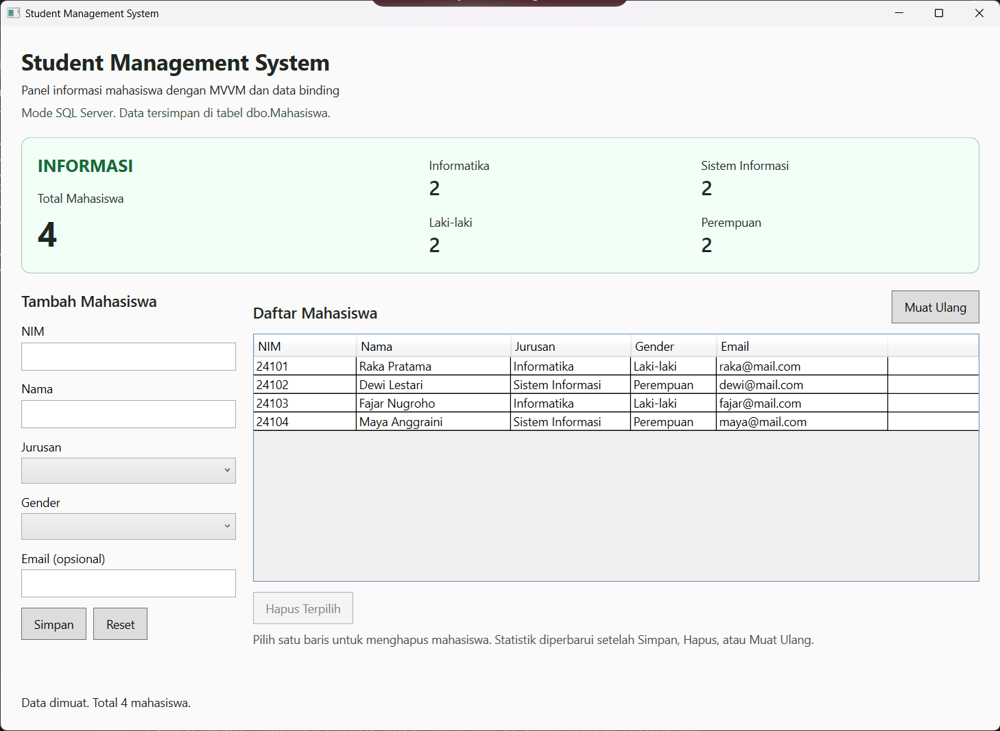
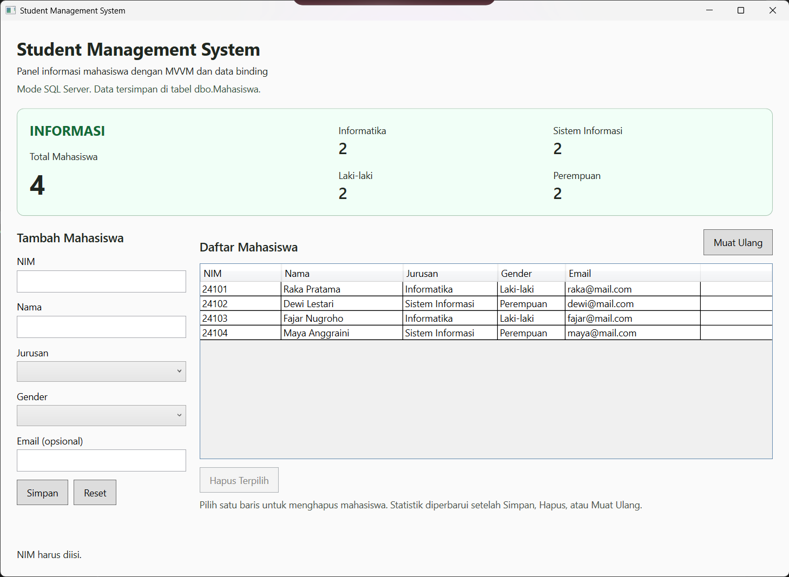
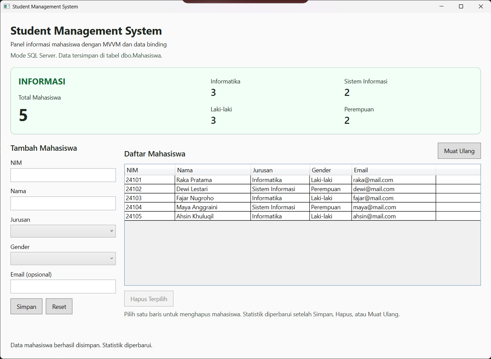
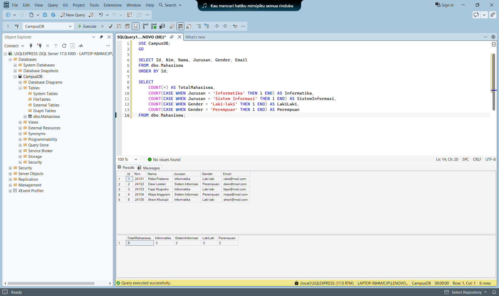
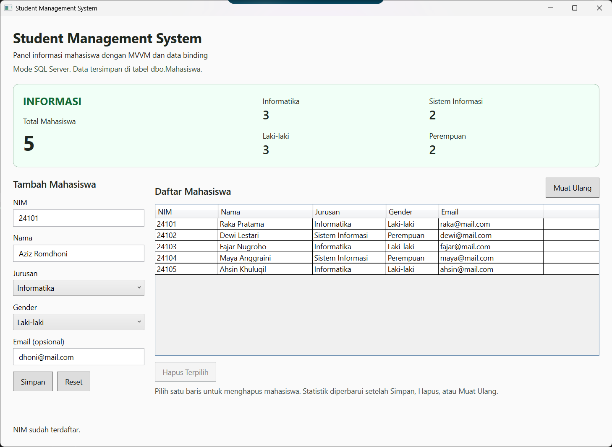
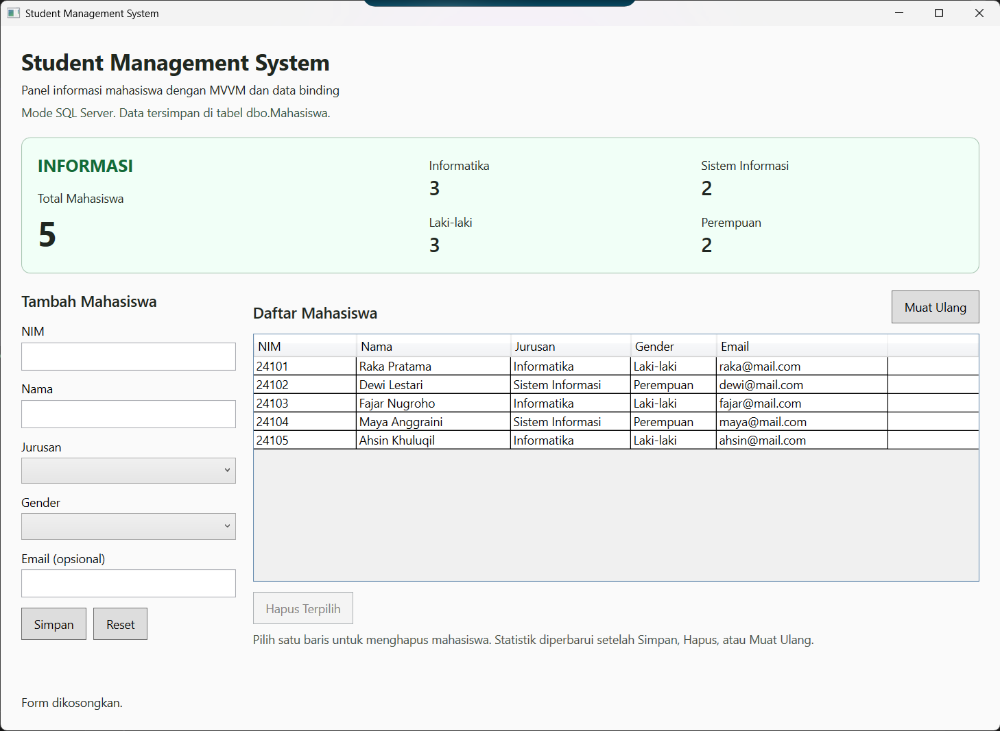
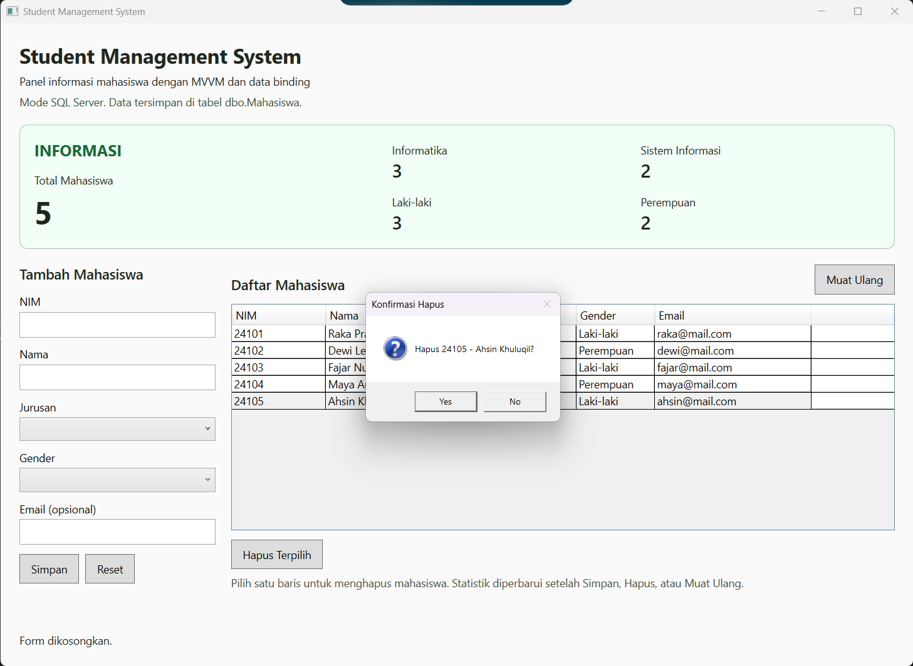
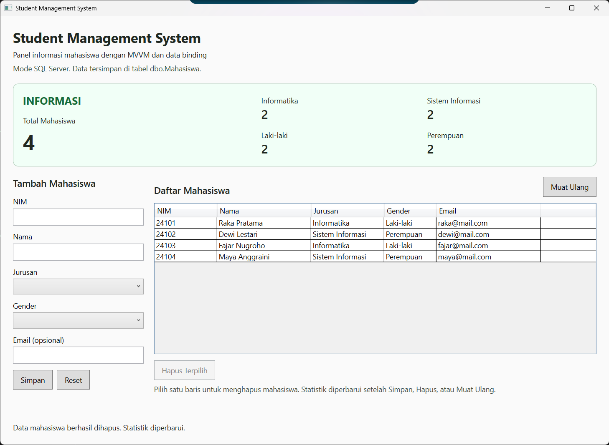
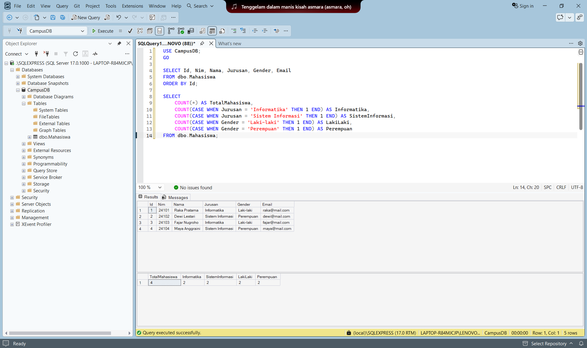

# StudentManagementApp

Aplikasi desktop **WPF (.NET 10)** untuk penugasan week 5, **Panel Informasi Student Management System**. Implementasi statistik dihitung di `StudentViewModel` menggunakan LINQ, lalu ditampilkan melalui WPF Data Binding.

---

## Penjelasan Program

Panel **INFORMASI** menampilkan Total Mahasiswa, Informatika, Sistem Informasi, Laki-laki, dan Perempuan. Form dan daftar mahasiswa digunakan untuk mengamati perubahan statistik setelah penambahan, penghapusan, dan pemuatan ulang data. Field mahasiswa terdiri dari Id, NIM, Nama, Jurusan, Gender, dan Email.

Pada praktikum ini, aplikasi langsung menggunakan **SQL Server Express** pada instance **`.\SQLEXPRESS`**, database **`CampusDB`**, dan tabel **`dbo.Mahasiswa`**. `StudentRepository` membaca dan mengubah data pada database. Data tetap tersimpan setelah aplikasi ditutup. Email opsional; email kosong disimpan sebagai NULL.

Koneksi diatur melalui environment variable `WEEK5_SQL_CONNECTION` sebelum aplikasi dijalankan. Jendela harus menampilkan **Mode SQL Server**. Pastikan variabel tersebut diisi pada setiap sesi terminal baru, karena kode aplikasi masih menyediakan mode memori apabila variabel koneksi tidak diatur. Seluruh panduan dan screenshot pada laporan ini menggunakan koneksi SQL Server.

### Arsitektur dan Komponen Utama

1. **App.xaml dan App.xaml.cs**: titik awal aplikasi, StartupUri, dan converter visibilitas.
2. **Models/Student.cs**: model data sesuai field modul.
3. **Repositories/IStudentRepository.cs**: kontrak `GetAll()`, `Insert()`, dan `Delete()`.
4. **Repositories/StudentRepository.cs**: akses tabel `CampusDB.dbo.Mahasiswa` secara asynchronous melalui query berparameter untuk SELECT, INSERT, dan DELETE.
5. **ViewModels/StudentViewModel.cs**: ObservableCollection, statistik LINQ, validasi, pemuatan data, status, serta notifikasi perubahan property.
6. **ViewModels/AsyncCommand.cs**: ICommand untuk Simpan, Reset, Hapus Terpilih, dan Muat Ulang. Tombol dinonaktifkan selama operasi berlangsung.
7. **MainWindow.xaml**: form, DataGrid, dan panel INFORMASI. Angka statistik hanya mengambil nilai lewat binding.
8. **MainWindow.xaml.cs**: membaca konfigurasi koneksi, membuat StudentRepository saat koneksi diatur, menetapkan DataContext, memanggil pemuatan awal, serta menampilkan konfirmasi hapus. Perhitungan statistik berada di ViewModel.

### Pemenuhan Requirement Tugas

| Ketentuan modul | Implementasi |
| --- | --- |
| Student model | Id, NIM, Nama, Jurusan, Gender, Email |
| ObservableCollection Student | `Students` di `StudentViewModel` |
| Total Mahasiswa | `TotalStudents => Students.Count` |
| Jumlah Informatika | `TotalInformatika` dengan LINQ Count berdasarkan Jurusan |
| Jumlah Sistem Informasi | `TotalSistemInformasi` dengan LINQ Count berdasarkan Jurusan |
| Jumlah Laki-laki | `TotalLakiLaki` dengan LINQ Count berdasarkan Gender |
| Jumlah Perempuan | `TotalPerempuan` dengan LINQ Count berdasarkan Gender |
| Refresh Data Binding | `RefreshStatistics()` memanggil PropertyChanged untuk kelima statistik |
| LoadData dari repository | `LoadData()` menjalankan GetAll, Clear, Add, dan refresh statistik |
| Panel INFORMASI | Border hijau muda, judul, angka total, rincian jurusan dan gender |
| Binding TextBlock | `{Binding TotalStudents}` dan empat property statistik lainnya |
| Siklus setelah INSERT / DELETE | Repository Insert/Delete, Reload, RefreshStatistics, PropertyChanged, WPF Binding |
| SQL Server | StudentRepository mengakses CampusDB.dbo.Mahasiswa pada instance .\SQLEXPRESS |

### Logika dan Alur Data Binding

```text
SQL Server Express (.\SQLEXPRESS)
             |
   CampusDB.dbo.Mahasiswa
             |
       Repository.GetAll()
             |
 ObservableCollection<Student>
             |
     StudentViewModel
             |
        LINQ Count()
             |
 INotifyPropertyChanged
             |
       WPF Data Binding
             |
      Panel INFORMASI
```

Contoh property statistik:

```csharp
public int TotalStudents => Students.Count;
public int TotalInformatika =>
    Students.Count(x => x.Jurusan == "Informatika");
public int TotalSistemInformasi =>
    Students.Count(x => x.Jurusan == "Sistem Informasi");
public int TotalLakiLaki =>
    Students.Count(x => x.Gender == "Laki-laki");
public int TotalPerempuan =>
    Students.Count(x => x.Gender == "Perempuan");
```

Binding pada XAML:

```xml
<TextBlock Text="{Binding TotalStudents}" />
<TextBlock Text="{Binding TotalInformatika}" />
<TextBlock Text="{Binding TotalSistemInformasi}" />
<TextBlock Text="{Binding TotalLakiLaki}" />
<TextBlock Text="{Binding TotalPerempuan}" />
```

`ObservableCollection` memberi tahu DataGrid ketika item ditambah atau dihapus. Property hasil perhitungan seperti `TotalInformatika` tetap memerlukan `PropertyChanged`. Karena itu `RefreshStatistics()` mengirim notifikasi untuk kelima property. ViewModel juga mengamati `CollectionChanged` agar perubahan anggota koleksi memperbarui statistik.

Setelah Simpan atau Hapus, ViewModel membaca ulang repository melalui `Reload()`. Data baru diambil terlebih dahulu sebelum koleksi lama dibersihkan, sehingga kegagalan pembacaan tidak menghapus tampilan data terakhir. Jika perubahan database berhasil tetapi pembacaan ulang gagal, status meminta pengguna menekan Muat Ulang untuk menyinkronkan statistik.

---

## Prasyarat Sistem

- Windows 10 atau Windows 11.
- .NET SDK 10 dengan target `net10.0-windows` dan dukungan WPF.
- Visual Studio dengan .NET desktop development atau VS Code dengan dukungan C#.
- Paket NuGet `Microsoft.Data.SqlClient` versi 5.2.2, dipulihkan saat build.
- SQL Server Express dengan service **SQL Server (SQLEXPRESS)** berjalan.
- SQL Server Management Studio (SSMS) untuk menjalankan skrip dan memeriksa data.

```powershell
dotnet --version
```

---

## Cara Menjalankan dari Awal

### 1. Inisialisasi Proyek

Perintah pembuatan template awal:

```powershell
dotnet new wpf -n StudentManagementApp --framework net10.0
```

Kode proyek sudah tersedia. Tidak perlu mengulang perintah ini untuk menjalankan tugas.

### 2. Masuk ke Direktori Proyek

Dari folder week5:

```powershell
cd StudentManagementApp
```

### 3. Build Proyek

```powershell
dotnet build
```

### 4. Hubungkan SSMS dan Siapkan Database

Di jendela **Connect to Server** pada SSMS, pilih **Database Engine**, isi **Server name** dengan `.\SQLEXPRESS`, dan pilih **Windows Authentication**. Centang **Trust server certificate** jika tersedia, lalu klik **Connect**.

Jalankan seluruh isi `Database/01-create-database.sql` pada instance SQL Server melalui SSMS. Skrip pembuatan awal ini membuat database `CampusDB`, tabel `Mahasiswa`, dan memasukkan empat data yang diberikan: Raka Pratama (24101), Dewi Lestari (24102), Fajar Nugroho (24103), dan Maya Anggraini (24104). Jalankan sekali pada instance yang belum memiliki CampusDB; jika database dan data tersebut sudah dibuat, langsung atur koneksi tanpa mengulang skrip.

Struktur tabel mengikuti SQL penugasan: Id INT IDENTITY sebagai primary key, Nim VARCHAR(20) unik, Nama VARCHAR(100), Jurusan VARCHAR(100), Gender VARCHAR(20), serta Email VARCHAR(100) yang boleh NULL. Setelah skrip dijalankan, panel menampilkan Total 4, Informatika 2, Sistem Informasi 2, Laki-laki 2, dan Perempuan 2.

### 5. Atur Koneksi dan Jalankan Aplikasi

Di PowerShell pada direktori StudentManagementApp, atur connection string berikut dan jalankan aplikasi pada terminal yang sama. Nama instance harus sama dengan yang dipakai di SSMS:

```powershell
$env:WEEK5_SQL_CONNECTION = 'Server=.\SQLEXPRESS;Database=CampusDB;Integrated Security=True;Encrypt=True;TrustServerCertificate=True;Connect Timeout=5'
dotnet run
```

`Integrated Security=True` menggunakan akun Windows, sedangkan `TrustServerCertificate=True` digunakan untuk pengembangan lokal. Saat berhasil dimuat, aplikasi menampilkan mode SQL Server dan empat mahasiswa dari database. Jika muncul pesan operasi gagal, periksa nama instance, service SQL Server, dan keberadaan tabel dbo.Mahasiswa di CampusDB. Setelah mengubah connection string, tutup aplikasi lalu jalankan kembali agar konfigurasi baru dibaca.

Untuk memeriksa data dari SSMS:

```sql
USE CampusDB;
SELECT Id, Nim, Nama, Jurusan, Gender, Email
FROM dbo.Mahasiswa ORDER BY Id;

SELECT COUNT(*) AS TotalMahasiswa,
       COUNT(CASE WHEN Jurusan = N'Informatika' THEN 1 END) AS Informatika,
       COUNT(CASE WHEN Jurusan = N'Sistem Informasi' THEN 1 END) AS SistemInformasi,
       COUNT(CASE WHEN Gender = N'Laki-laki' THEN 1 END) AS LakiLaki,
       COUNT(CASE WHEN Gender = N'Perempuan' THEN 1 END) AS Perempuan
FROM dbo.Mahasiswa;
```

---

## Panduan Penggunaan dan Tangkapan Layar

Dokumentasi berikut menggunakan SQL Server Express pada `.\SQLEXPRESS`, database `CampusDB`, dan tabel `dbo.Mahasiswa`. Empat data awal berasal dari skrip database:

| NIM | Nama | Jurusan | Gender | Email |
| --- | --- | --- | --- | --- |
| 24101 | Raka Pratama | Informatika | Laki-laki | raka@mail.com |
| 24102 | Dewi Lestari | Sistem Informasi | Perempuan | dewi@mail.com |
| 24103 | Fajar Nugroho | Informatika | Laki-laki | fajar@mail.com |
| 24104 | Maya Anggraini | Sistem Informasi | Perempuan | maya@mail.com |

Data tambahan untuk pengujian INSERT dan DELETE adalah **24105 / Ahsin Khuluqil / Informatika / Laki-laki / ahsin@mail.com**. Urutan angka statistik pada penjelasan berikut adalah **Total Mahasiswa / Informatika / Sistem Informasi / Laki-laki / Perempuan**.

### 1. Tampilan Awal dengan Data SQL Server

Saat aplikasi dimuat, label **Mode SQL Server** menunjukkan penggunaan repository SQL. DataGrid menampilkan Raka, Dewi, Fajar, dan Maya dari tabel dbo.Mahasiswa. Statistik awal adalah **4 / 2 / 2 / 2 / 2** dan status menampilkan **Data dimuat. Total 4 mahasiswa.** Form kosong dan tombol Hapus Terpilih nonaktif karena belum ada baris dipilih.



---

### 2. Validasi Field Wajib

Klik **Simpan** saat form kosong menghasilkan status **NIM harus diisi.** Keempat data tetap ada dan statistik tidak berubah, yaitu **4 / 2 / 2 / 2 / 2**. Pesan validasi ditampilkan pada status di bagian bawah jendela.



---

### 3. Menambahkan Mahasiswa ke Database

Data **24105 / Ahsin Khuluqil / Informatika / Laki-laki / ahsin@mail.com** ditambahkan melalui form. Setelah **Simpan**, mahasiswa tersebut muncul sebagai baris kelima. Panel berubah menjadi **5 / 3 / 2 / 3 / 2**, form kembali kosong, dan status menampilkan **Data mahasiswa berhasil disimpan. Statistik diperbarui.**



---

### 4. Mencocokkan Statistik dengan SQL Server

Query SELECT dijalankan di SSMS setelah penambahan NIM 24105. Hasil query menampilkan lima baris, termasuk Ahsin Khuluqil. Hasil agregasi adalah **TotalMahasiswa 5, Informatika 3, SistemInformasi 2, LakiLaki 3, dan Perempuan 2**, sesuai panel aplikasi pada gambar sebelumnya.

Query yang digunakan:

```sql
USE CampusDB;
GO

SELECT Id, Nim, Nama, Jurusan, Gender, Email
FROM dbo.Mahasiswa
ORDER BY Id;

SELECT
    COUNT(*) AS TotalMahasiswa,
    COUNT(CASE WHEN Jurusan = 'Informatika' THEN 1 END) AS Informatika,
    COUNT(CASE WHEN Jurusan = 'Sistem Informasi' THEN 1 END) AS SistemInformasi,
    COUNT(CASE WHEN Gender = 'Laki-laki' THEN 1 END) AS LakiLaki,
    COUNT(CASE WHEN Gender = 'Perempuan' THEN 1 END) AS Perempuan
FROM dbo.Mahasiswa;
```



---

### 5. Validasi NIM Duplikat

Form diisi dengan NIM **24101**, nama **Aziz Romdhoni**, jurusan **Informatika**, gender **Laki-laki**, dan email **dhoni@mail.com**. NIM 24101 sudah dimiliki Raka Pratama, sehingga aplikasi menolak penyimpanan dengan status **NIM sudah terdaftar.** Jumlah data tetap lima dan statistik tetap **5 / 3 / 2 / 3 / 2**.



---

### 6. Reset Form

Setelah percobaan duplikat, klik **Reset** mengosongkan NIM, nama, jurusan, gender, dan email. Status berubah menjadi **Form dikosongkan.** Lima data yang sudah tersimpan tetap tersedia dan statistik tetap **5 / 3 / 2 / 3 / 2**.



---

### 7. Konfirmasi Hapus

Baris **24105 / Ahsin Khuluqil** dipilih lalu tombol **Hapus Terpilih** ditekan. Aplikasi menampilkan dialog **Konfirmasi Hapus** dengan pesan **Hapus 24105 - Ahsin Khuluqil?** Tombol **Yes** melanjutkan penghapusan, sedangkan **No** membatalkannya. Saat dialog masih terbuka, panel tetap menunjukkan **5 / 3 / 2 / 3 / 2**.



---

### 8. Statistik Setelah DELETE

Setelah penghapusan dikonfirmasi, NIM 24105 tidak lagi tampil. Daftar kembali berisi empat mahasiswa awal dan statistik menjadi **4 / 2 / 2 / 2 / 2**. Status menampilkan **Data mahasiswa berhasil dihapus. Statistik diperbarui.**



---

### 9. Bukti Integrasi SQL Server Setelah Penghapusan

Query data dan agregasi dijalankan kembali di SSMS. Hasilnya hanya memuat Raka, Dewi, Fajar, dan Maya; NIM 24105 sudah tidak ada pada tabel dbo.Mahasiswa. Hasil agregasi **4 / 2 / 2 / 2 / 2** sesuai panel aplikasi setelah DELETE. Perbandingan gambar sebelum dan sesudah penghapusan menunjukkan perubahan data juga tersimpan pada SQL Server.



---

### 10. Pemuatan Data dan Pemeriksaan Persistensi

Lampiran berikut menampilkan mode SQL Server, empat data awal, statistik **4 / 2 / 2 / 2 / 2**, dan status **Data dimuat. Total 4 mahasiswa.**


---

## Skenario Pengujian

Dokumentasi manual di atas memperlihatkan pemuatan data SQL Server, validasi NIM kosong, penambahan data, kecocokan statistik dengan query agregasi, penolakan NIM duplikat, reset form, konfirmasi hapus, dan penghapusan pada database.

| Skenario | Hasil pada dokumentasi | Bukti |
| --- | --- | --- |
| Pemuatan awal SQL Server | Empat baris, statistik 4 / 2 / 2 / 2 / 2 | 01-awal.png |
| Simpan dengan form kosong | Status NIM harus diisi; data tetap empat | 02-validasi.png |
| INSERT NIM 24105 | Lima baris, statistik 5 / 3 / 2 / 3 / 2 | 03-tambah.png |
| SELECT data dan agregasi setelah INSERT | Lima baris dan kelima angka sama dengan panel | 04-statistik.png |
| Simpan NIM 24101 duplikat | Ditolak; data tetap lima | 05-duplikat.png |
| Reset form | Form kosong; lima data tetap ada | 06-reset.png |
| Hapus mahasiswa terpilih | Dialog menyebut NIM dan nama dengan pilihan Yes/No | 07-konfirmasi-hapus.png |
| DELETE NIM 24105 | Daftar kembali empat, statistik 4 / 2 / 2 / 2 / 2 | 08-hapus.png |
| SELECT setelah DELETE | NIM 24105 tidak ada; agregasi 4 / 2 / 2 / 2 / 2 | 09-sql-server.png |
| Tutup dan buka kembali aplikasi | Perlu screenshot baru untuk membuktikan proses buka ulang | 10-persistensi.png |

---

## Struktur Direktori Proyek

```text
week5/
  WPF_Student_Management_Panel_Informasi_Data_Binding.pdf
  StudentManagementApp/
    images/                          Screenshot dokumentasi SQL Server
    Database/01-create-database.sql  Skrip SQL Server
    Models/Student.cs                Model mahasiswa
    Repositories/
      IStudentRepository.cs          Kontrak repository
      StudentRepository.cs           Implementasi SQL Server
      DemoStudentRepository.cs       Repository alternatif di memori
    ViewModels/
      AsyncCommand.cs                ICommand asynchronous
      StudentViewModel.cs            Koleksi, statistik, validasi, notifikasi
    App.xaml                         Titik awal WPF dan resource
    App.xaml.cs                      Kelas aplikasi
    MainWindow.xaml                  Tampilan dengan data binding
    MainWindow.xaml.cs               DataContext dan dialog konfirmasi
    StudentManagementApp.csproj      Konfigurasi proyek
    README.md                        Laporan week 5
```
