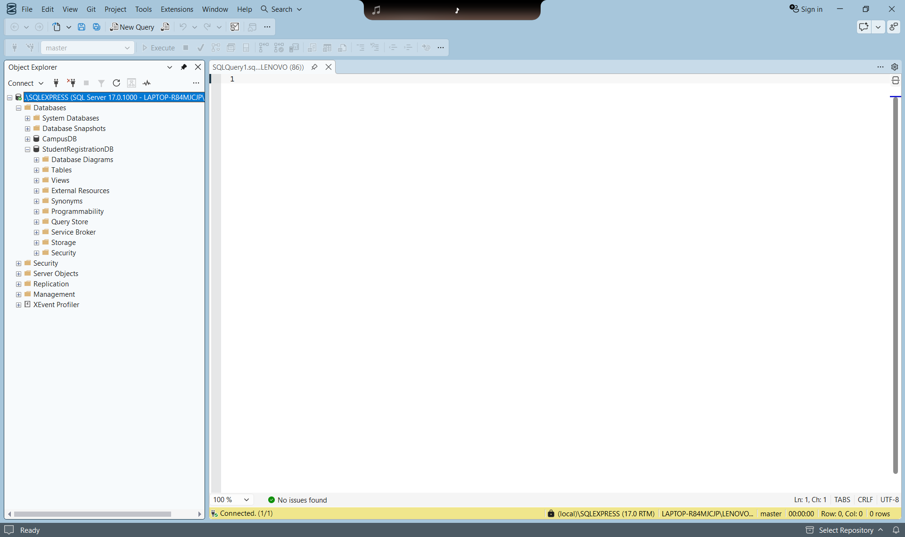
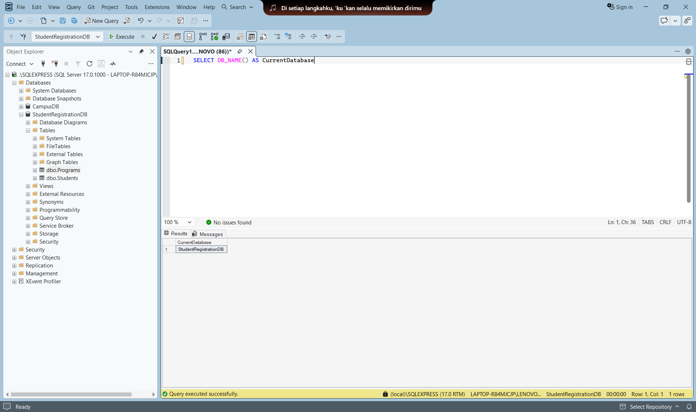
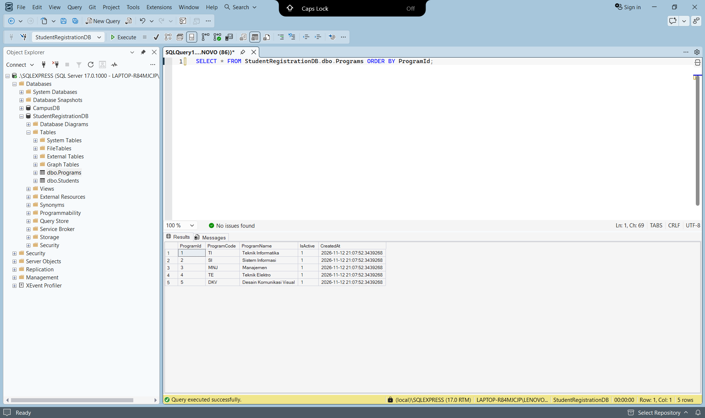
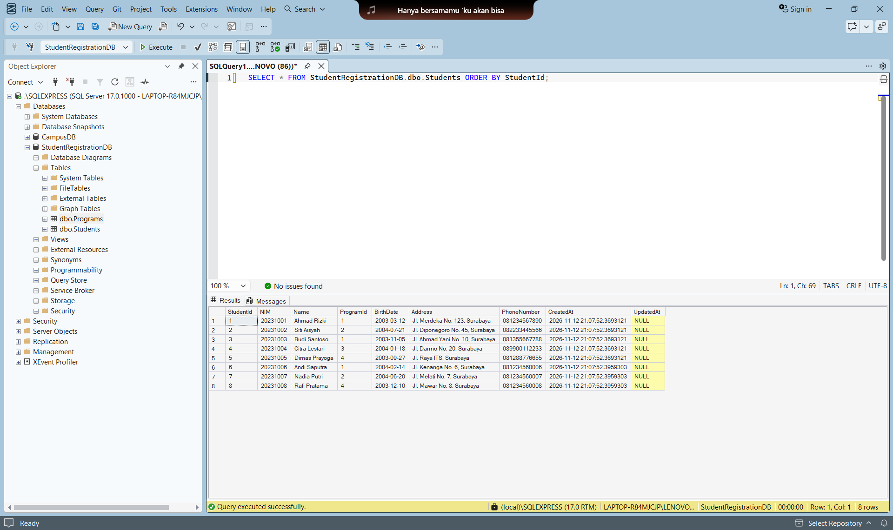
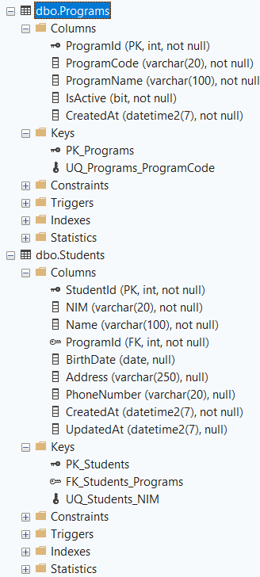
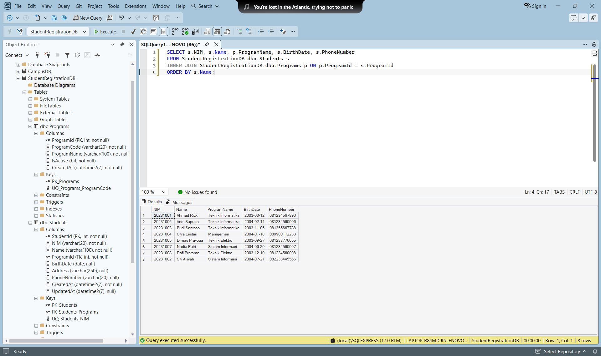
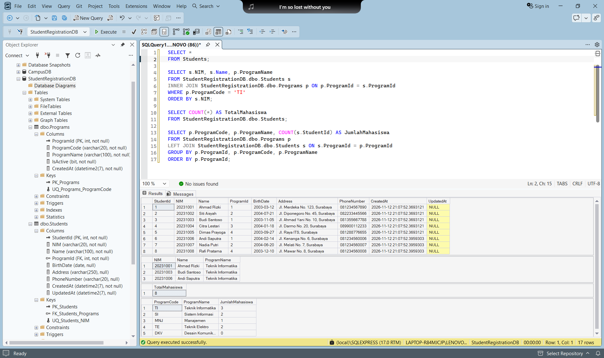
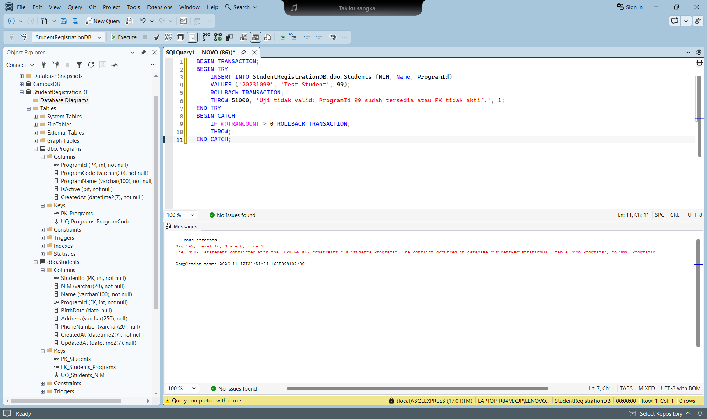
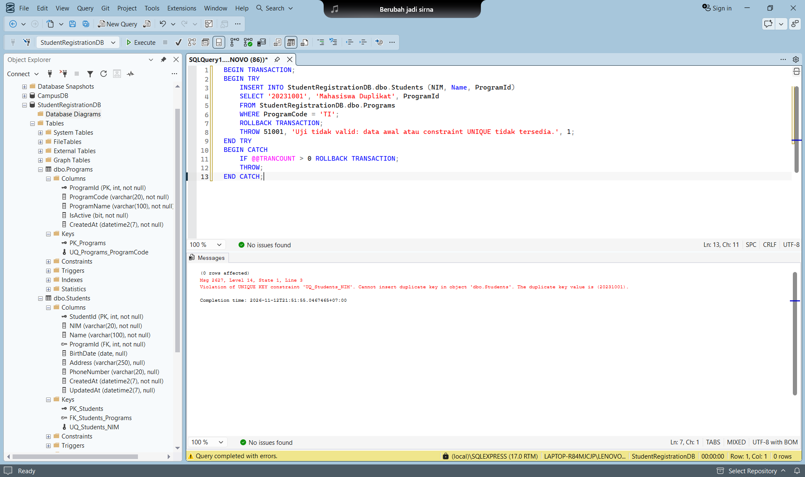

# Student Registration Database

Laporan tugas 1 week 6 untuk praktikum **Membangun Database Student Registration dengan SQL Server**. Database `StudentRegistrationDB` berisi tabel `Programs` dan `Students` dengan relasi satu program studi memiliki banyak mahasiswa.

---

## Penjelasan Program

Praktikum ini menyiapkan penyimpanan data untuk aplikasi WPF pada tugas 2. Tabel Programs menyimpan program studi, sedangkan Students menyimpan identitas mahasiswa dan referensi program studinya. Primary key membedakan setiap baris, unique key mencegah kode program/NIM duplikat, dan foreign key memastikan program mahasiswa tersedia.

### Arsitektur dan Komponen Utama

```text
SQL Server Express (.\SQLEXPRESS)
  StudentRegistrationDB
    StudentRegistrationDB.dbo.Programs (PK: ProgramId, UNIQUE: ProgramCode)
       1
       |
       N
    StudentRegistrationDB.dbo.Students (PK: StudentId, UNIQUE: NIM, FK: ProgramId)
```

| Skrip | Fungsi |
| --- | --- |
| `Database/01-setup.sql` | Membuat database, tabel, constraint, 5 program studi dan 5 mahasiswa awal |
| `Database/02-query-dan-constraint.sql` | SELECT, JOIN, WHERE, COUNT, GROUP BY dan dua uji penolakan constraint |
| `Database/03-mini-assignment.sql` | Menambah masing-masing 1 mahasiswa TI, SI, TE dan menampilkan JOIN terurut nama |
| `Database/04-query-screenshot.sql` | Query baca untuk screenshot; dapat dijalankan langsung dari database aktif master |
| `Database/StudentRegistrationDB-lengkap.sql` | Gabungan seluruh skrip untuk pengumpulan file SQL |

### Pemenuhan Requirement Tugas

| Ketentuan modul | Implementasi |
| --- | --- |
| SQL Server lokal dan SSMS | Koneksi `.\SQLEXPRESS` dengan Windows Authentication |
| Database | `StudentRegistrationDB` |
| Programs | ProgramId, ProgramCode, ProgramName, IsActive, CreatedAt |
| Students | StudentId, NIM, Name, ProgramId, BirthDate, Address, PhoneNumber, CreatedAt, UpdatedAt |
| Primary key | `PK_Programs`, `PK_Students`, kolom INT IDENTITY(1,1) |
| Unique key | `UQ_Programs_ProgramCode`, `UQ_Students_NIM` |
| Foreign key 1:N | `FK_Students_Programs`, Students.ProgramId merujuk Programs.ProgramId |
| Nilai default | IsActive = 1 dan CreatedAt = SYSDATETIME() |
| Query challenge | Semua mahasiswa, mahasiswa TI, total mahasiswa, jumlah per program |
| Mini assignment | Andi Saputra (TI), Nadia Putri (SI), Rafi Pratama (TE) |
| Hasil akhir | JOIN dengan ORDER BY s.Name dan file SQL lengkap |

### Logika dan Query

Skrip mencari ProgramId berdasarkan ProgramCode, sehingga tidak mengandalkan angka identity tertentu. Pemeriksaan `NOT EXISTS` mencegah data awal masuk dua kali ketika skrip diulang. Data yang sudah ada tidak diubah oleh skrip seed.

```sql
SELECT s.NIM, s.Name, p.ProgramName, s.BirthDate, s.PhoneNumber
FROM StudentRegistrationDB.dbo.Students s
INNER JOIN StudentRegistrationDB.dbo.Programs p ON s.ProgramId = p.ProgramId
ORDER BY s.Name;
```

`INNER JOIN` menampilkan mahasiswa beserta nama programnya. Untuk menghitung mahasiswa per program, `LEFT JOIN` tetap menyertakan DKV walaupun belum mempunyai mahasiswa. Gunakan `COUNT(s.StudentId)`, bukan `COUNT(*)`, agar program tanpa mahasiswa menghasilkan 0.

---

## Prasyarat Sistem

- Windows dengan SQL Server Developer atau Express dan Database Engine Services.
- SQL Server Management Studio (SSMS).
- Instance lokal yang digunakan pada pengerjaan: `.\SQLEXPRESS`.
- Akun Windows dengan izin membuat database dan tabel pada instance tersebut.

## Cara Menjalankan dari Awal

Jika muncul `Invalid object name 'dbo.Programs'` atau `dbo.Students`, periksa dropdown database di toolbar SSMS. Pilih **StudentRegistrationDB**, bukan **master**. Memilih database pada Object Explorer tidak mengganti database aktif tab query yang sudah terbuka.

Alternatifnya, jalankan `USE StudentRegistrationDB;` terlebih dahulu pada tab query tersebut. Jika hanya sebagian skrip disorot, SSMS menjalankan bagian yang disorot saja; baris USE di luar sorotan tidak ikut dijalankan. Contoh SELECT di laporan ini memakai nama database lengkap agar tetap berjalan dari master. File `Database/04-query-screenshot.sql` menyediakan semua query baca untuk screenshot tanpa pengujian yang sengaja memunculkan error.

### 1. Menyiapkan SQL Server dan SSMS

Jika SQL Server belum terpasang, jalankan installer SQL Server, pilih instalasi standalone, aktifkan **Database Engine Services**, gunakan named instance **SQLEXPRESS**, lalu pilih **Windows Authentication** dan tambahkan akun Windows sebagai administrator SQL Server. Pasang SSMS setelah Database Engine tersedia. Pada komputer pengerjaan, SQL Server sudah terpasang dan service **SQL Server (SQLEXPRESS)** sudah berjalan sehingga tidak diinstal ulang.

Buka SSMS, pilih Server type **Database Engine**, Server name **`.\SQLEXPRESS`**, Authentication **Windows Authentication**, lalu Connect. Untuk sertifikat pengembangan lokal, gunakan Trust server certificate jika dibutuhkan. Jika instance berbeda, sesuaikan server di SSMS dan koneksi tugas 2.

### 2. Membuat Database dan Data Awal

Buka `Database/01-setup.sql` di SSMS, lalu Execute/F5. Skrip membuat dua tabel beserta constraint dan memasukkan lima mahasiswa dari modul. Periksa database melalui:

```sql
USE StudentRegistrationDB;
SELECT DB_NAME() AS CurrentDatabase;
SELECT * FROM StudentRegistrationDB.dbo.Programs ORDER BY ProgramId;
SELECT * FROM StudentRegistrationDB.dbo.Students ORDER BY StudentId;
```

Pada database baru, tahap ini menghasilkan 5 program studi dan 5 mahasiswa. Jika mini assignment sudah dijalankan sebelumnya, Students tetap berisi 8 mahasiswa. Setup tidak menghapus tiga mahasiswa tambahan.

### 3. Menjalankan Query Challenge dan Uji Constraint

Buka `02-query-dan-constraint.sql`. Jalankan SELECT, JOIN, WHERE, COUNT dan GROUP BY. Kemudian sorot dan jalankan setiap blok pengujian constraint secara terpisah, dari `BEGIN TRANSACTION` sampai `END CATCH`.

Pengujian ProgramId 99 harus gagal dengan error **547** karena program tersebut tidak tersedia. Pengujian NIM 20231001 harus gagal dengan error **2627** karena NIM sudah terdaftar. Error tersebut adalah hasil yang diharapkan. Kedua blok memakai rollback agar baris uji tidak tersimpan jika kondisi database berubah. Uji ProgramId 99 mengasumsikan belum ada program dengan ID 99.

### 4. Menyelesaikan Mini Assignment

Jalankan `03-mini-assignment.sql`. Tiga data berikut merupakan data contoh tambahan untuk tugas:

| NIM | Nama | Program studi |
| --- | --- | --- |
| 20231006 | Andi Saputra | Teknik Informatika |
| 20231007 | Nadia Putri | Sistem Informasi |
| 20231008 | Rafi Pratama | Teknik Elektro |

Total akhir adalah **8 mahasiswa**: TI 3, SI 2, Manajemen 1, TE 2, dan DKV 0. Hasil JOIN terurut nama menampilkan Ahmad Rizki, Andi Saputra, Budi Santoso, Citra Lestari, Dimas Prayoga, Nadia Putri, Rafi Pratama, dan Siti Aisyah.

---

## Panduan Penggunaan dan Tangkapan Layar

Dokumentasi berikut menggunakan SQL Server Express pada `.\SQLEXPRESS` dan database `StudentRegistrationDB`. Query praktikum tersedia pada file SQL di folder `Database/`.

### 1. SQL Server Berhasil Terkoneksi

Object Explorer menampilkan koneksi ke `.\SQLEXPRESS` serta database CampusDB dan StudentRegistrationDB. Status bawah SSMS menunjukkan **Connected (1/1)**. Ini menunjukkan SQL Server dapat diakses menggunakan akun Windows pada komputer praktikum.



### 2. Database StudentRegistrationDB

Database aktif pada toolbar adalah **StudentRegistrationDB**. Query `SELECT DB_NAME() AS CurrentDatabase;` menghasilkan StudentRegistrationDB. Object Explorer memperlihatkan tabel `dbo.Programs` dan `dbo.Students` di dalam database tersebut.



### 3. Tabel Programs

Query SELECT menampilkan lima program studi: TI (Teknik Informatika), SI (Sistem Informasi), MNJ (Manajemen), TE (Teknik Elektro), dan DKV (Desain Komunikasi Visual). Setiap program memiliki ProgramId, ProgramCode, ProgramName, IsActive bernilai 1, dan CreatedAt yang terisi.



### 4. Tabel Students

Tabel Students berisi delapan mahasiswa dengan NIM 20231001 sampai 20231008. Tiga baris terakhir adalah Andi Saputra, Nadia Putri, dan Rafi Pratama dari mini assignment. Kolom ProgramId menghubungkan setiap mahasiswa dengan program studinya. BirthDate, Address, PhoneNumber, dan CreatedAt terisi, sedangkan UpdatedAt masih NULL.



### 5. Struktur Kolom dan Relasi

Object Explorer memperlihatkan kolom serta Keys kedua tabel. Programs memiliki primary key `PK_Programs` dan unique key `UQ_Programs_ProgramCode`. Students memiliki `PK_Students`, `UQ_Students_NIM`, dan foreign key `FK_Students_Programs`. Kolom ProgramId pada Students ditandai sebagai FK, sehingga satu program dapat dirujuk oleh banyak mahasiswa.



### 6. Hasil JOIN Mini Assignment

INNER JOIN menampilkan NIM, Name, ProgramName, BirthDate, dan PhoneNumber untuk delapan mahasiswa. Hasil diurutkan menurut nama: Ahmad Rizki, Andi Saputra, Budi Santoso, Citra Lestari, Dimas Prayoga, Nadia Putri, Rafi Pratama, dan Siti Aisyah. Tiga mahasiswa tambahan tergabung dengan program yang sesuai: Andi di Teknik Informatika, Nadia di Sistem Informasi, dan Rafi di Teknik Elektro.



### 7. Query Challenge

Empat hasil query ditampilkan: seluruh mahasiswa, mahasiswa Teknik Informatika, total mahasiswa, dan jumlah per program. Filter TI menghasilkan Ahmad Rizki, Budi Santoso, dan Andi Saputra. TotalMahasiswa bernilai **8**. Agregasi menghasilkan **TI 3, SI 2, MNJ 1, TE 2, dan DKV 0**. Program DKV tetap ditampilkan karena penghitungan menggunakan LEFT JOIN.



### 8. Penolakan Foreign Key

INSERT mahasiswa dengan ProgramId **99** ditolak. Tab Messages menampilkan **Msg 547** dan menyebut constraint `FK_Students_Programs`, tabel dbo.Programs, serta kolom ProgramId. Hasil ini menunjukkan mahasiswa tidak dapat merujuk program yang tidak tersedia. Blok CATCH melakukan rollback sebelum meneruskan pesan error.



### 9. Penolakan NIM Duplikat

INSERT dengan NIM **20231001** ditolak karena NIM tersebut sudah dimiliki Ahmad Rizki. Tab Messages menampilkan **Msg 2627**, constraint `UQ_Students_NIM`, dan duplicate key value 20231001. Pengujian ini membuktikan NIM harus unik. Error pada gambar 08 dan 09 merupakan hasil pengujian constraint yang diharapkan.



---

## Skenario Pengujian

Pengujian database berikut sudah dijalankan pada `.\SQLEXPRESS` dan didokumentasikan pada sembilan screenshot di atas.

| Skenario | Hasil pemeriksaan |
| --- | --- |
| Setup dan mini assignment | Berhasil; database tersedia dengan 5 program dan 8 mahasiswa |
| Agregasi per program | TI 3, SI 2, MNJ 1, TE 2, DKV 0 |
| ProgramId tidak tersedia | Ditolak dengan SQL error 547 |
| NIM duplikat | Ditolak dengan SQL error 2627 |
| Bukti visual SSMS | Screenshot 01 sampai 09 tersedia dan sesuai dengan hasil query |

Pengujian dapat diulang melalui file `Database/02-query-dan-constraint.sql`. Jalankan bagian SELECT untuk memeriksa data, lalu jalankan masing-masing blok uji constraint secara terpisah. Error 547 dan 2627 pada blok pengujian adalah hasil yang diharapkan.

## Struktur Direktori Proyek

```text
Tugas1-Database/
  Database/
    01-setup.sql
    02-query-dan-constraint.sql
    03-mini-assignment.sql
    04-query-screenshot.sql
    StudentRegistrationDB-lengkap.sql
  images/
    01-koneksi.png ... 09-unique-nim.png
  README.md
```
