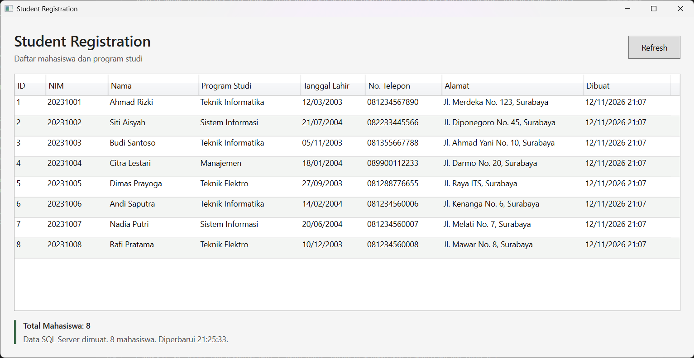
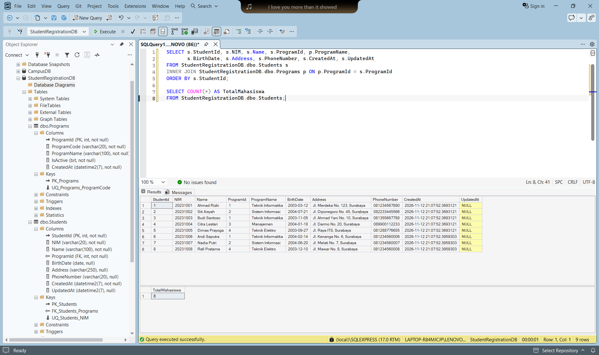

# StudentRegistration

Aplikasi desktop **WPF (.NET 10)** untuk tugas 2 week 6, **WPF + C# Terhubung SQL Server dengan ADO.NET**. Aplikasi membaca `StudentRegistrationDB` dari tugas 1 dan menampilkan data mahasiswa dalam DataGrid.

---

## Penjelasan Program

Saat jendela dibuka, aplikasi mengambil data mahasiswa beserta program studinya dari SQL Server. Tombol Refresh membaca ulang database. DataGrid bersifat read-only karena cakupan tugas ini adalah koneksi dan pembacaan data, sedangkan CRUD berada pada tahap lab berikutnya.

Mini challenge turut diterapkan: kolom **Alamat**, kolom **Dibuat**, dan **Total Mahasiswa** dari query `SELECT COUNT(*) FROM dbo.Students` pada koneksi ke database StudentRegistrationDB. Aplikasi memakai database langsung tanpa mode data contoh di memori.

### Arsitektur dan Komponen Utama

1. `App.xaml` dan `App.xaml.cs` menetapkan titik awal WPF menuju MainWindow.
2. `Models/Student.cs` menampung identitas, program studi, tanggal lahir, alamat, telepon, dan waktu pencatatan mahasiswa.
3. `Models/Program.cs` merepresentasikan program studi; file ini bukan entry point C#.
4. `Repositories/StudentRepository.cs` mengelola SqlConnection, SqlCommand, SqlDataReader, query JOIN, dan COUNT.
5. `MainWindow.xaml` berisi DataGrid, tombol Refresh, jumlah mahasiswa, status, dan pesan data kosong.
6. `MainWindow.xaml.cs` memanggil repository, memasang ItemsSource, memperbarui total/status, dan menampilkan kesalahan koneksi.

### Pemenuhan Requirement Tugas

| Ketentuan modul | Implementasi |
| --- | --- |
| Project WPF C# | `StudentRegistration.csproj`, target net10.0-windows dan UseWPF |
| Student.cs | Seluruh field Students dan ProgramName hasil JOIN |
| Program.cs | ProgramId, ProgramCode, ProgramName, IsActive |
| StudentRepository.cs | GetAll() dan GetSnapshot() |
| Connection string | Default `.\SQLEXPRESS`, database StudentRegistrationDB, Windows Authentication |
| Microsoft.Data.SqlClient | PackageReference versi 5.2.2, sama seperti proyek week 5 |
| SqlConnection / SqlCommand | Membuka koneksi dan menjalankan SQL |
| SqlDataReader | Membaca baris hasil SELECT dan memetakan objek Student |
| List<Student> | Hasil pembacaan repository |
| DataGrid dan binding | ItemsSource serta binding property pada delapan kolom |
| Tombol Refresh | Memuat ulang daftar dan total mahasiswa |
| Mini challenge Address | Kolom Alamat, binding Address |
| Mini challenge CreatedAt | Kolom Dibuat, format dd/MM/yyyy HH:mm |
| Mini challenge total | Query COUNT(*) dan label Total Mahasiswa |

### Logika dan Alur Data

```text
Window Loaded / tombol Refresh
  MainWindow.LoadStudents()
    StudentRepository.GetSnapshot()
      SqlConnection.Open()
      SqlCommand: SELECT Students INNER JOIN Programs
      SqlDataReader -> Student -> List<Student>
      SqlCommand: SELECT COUNT(*) FROM Students
    StudentDataGrid.ItemsSource = snapshot.Students
    TotalText = snapshot.Total
```

`GetAll()` tersedia sebagai metode pembacaan dasar sesuai modul. UI menggunakan `GetSnapshot()` untuk membaca daftar dan total dalam satu transaksi berisolasi Serializable. Kedua hasil mengacu pada kumpulan data yang sama selama pembacaan. Transaksi selesai sebelum data dipasang ke UI.

Pembacaan dijalankan melalui `Task.Run`, sehingga jendela tetap merespons saat SQL Server bekerja. Tombol Refresh dinonaktifkan selama pemuatan. Setelah selesai, tombol aktif lagi. Saat pembacaan gagal, aplikasi menampilkan dialog **Database Error**, status berisi petunjuk pemeriksaan, dan daftar terakhir tetap tersedia. Untuk hasil nol baris, aplikasi menampilkan **Belum ada mahasiswa di database.**

```csharp
var snapshot = await Task.Run(() => _studentRepository.GetSnapshot());
StudentDataGrid.ItemsSource = snapshot.Students;
TotalText.Text = $"Total Mahasiswa: {snapshot.Total}";
```

Contoh binding kolom tambahan:

```xml
<DataGridTextColumn Header="Alamat" Binding="{Binding Address}" Width="250" />
<DataGridTextColumn Header="Dibuat"
                    Binding="{Binding CreatedAt, StringFormat=dd/MM/yyyy HH:mm}"
                    Width="155" />
```

Nilai SQL NULL untuk BirthDate dan UpdatedAt dipetakan menjadi `DateTime?`. NULL pada Address dan PhoneNumber dipetakan menjadi string kosong. Pemakaian `using` menutup reader, command, transaksi, dan koneksi setelah operasi selesai.

---

## Prasyarat Sistem

- Windows 10 atau 11 dan .NET SDK 10, sesuai proyek minggu sebelumnya.
- SQL Server Express dengan service SQL Server (SQLEXPRESS) berjalan.
- Database StudentRegistrationDB, Programs, dan Students dari tugas 1.
- Paket NuGet Microsoft.Data.SqlClient 5.2.2; dipulihkan ketika build.
- SSMS untuk memeriksa data dan mengambil screenshot SQL.

Modul memberi .NET 8 sebagai contoh dan mengizinkan framework laboratorium. Implementasi memakai .NET 10 yang terpasang di komputer pengerjaan.

## Cara Menjalankan dari Awal

### 1. Menyiapkan Database

Selesaikan tugas 1 dengan menjalankan `../../Tugas1-Database/Database/01-setup.sql` lalu `03-mini-assignment.sql` dari folder proyek ini. File dibuka dan dijalankan melalui SSMS. Jalur tersebut relatif terhadap `week6/Tugas2-WPF/StudentRegistration`.

Pastikan query berikut menghasilkan 8 baris setelah mini assignment:

```sql
USE StudentRegistrationDB;
SELECT s.StudentId, s.NIM, s.Name, s.ProgramId, p.ProgramName, s.BirthDate,
       s.Address, s.PhoneNumber, s.CreatedAt, s.UpdatedAt
FROM StudentRegistrationDB.dbo.Students s
INNER JOIN StudentRegistrationDB.dbo.Programs p ON p.ProgramId = s.ProgramId
ORDER BY s.StudentId;
SELECT COUNT(*) AS TotalMahasiswa FROM StudentRegistrationDB.dbo.Students;
```

### 2. Build Proyek

Dari folder week6:

```powershell
cd .\Tugas2-WPF\StudentRegistration
dotnet build
```

Kode proyek sudah disediakan. Tidak perlu membuat template baru. Perintah template awal sebagai referensi adalah `dotnet new wpf -n StudentRegistration --framework net10.0`.

### 3. Mengatur Koneksi

Koneksi default menggunakan:

```text
Server=.\SQLEXPRESS;Database=StudentRegistrationDB;
Trusted_Connection=True;TrustServerCertificate=True;Connect Timeout=5;
```

Jika instance Anda sama, aplikasi dapat langsung dijalankan. Untuk instance lain, atur environment variable sebelum menjalankan aplikasi dari terminal yang sama:

```powershell
$env:WEEK6_SQL_CONNECTION = 'Server=.\SQLEXPRESS;Database=StudentRegistrationDB;Trusted_Connection=True;TrustServerCertificate=True;Connect Timeout=5;'
dotnet run
```

Windows Authentication memakai akun Windows yang menjalankan aplikasi. TrustServerCertificate digunakan untuk sertifikat SQL Server pengembangan lokal. Tutup dan jalankan kembali aplikasi setelah mengganti environment variable.

### 4. Menjalankan dan Memakai Aplikasi

```powershell
dotnet run
```

Jendela menampilkan delapan mahasiswa dan label **Total Mahasiswa: 8**. Klik **Refresh** atau tekan **Alt+R** untuk membaca ulang database. Gunakan scroll horizontal agar kolom Alamat dan Dibuat terlihat pada jendela yang sempit, atau maksimalkan jendela untuk screenshot. Klik header kolom untuk mengurutkan tampilan. Refresh mengembalikan urutan StudentId dari query repository.

---

## Panduan Penggunaan dan Tangkapan Layar

Aplikasi menggunakan database yang sama dengan tugas 1. Tiga screenshot berikut memperlihatkan data pada DataGrid, hasil Refresh, dan query pembanding di SSMS. Data terdiri dari lima mahasiswa awal dan tiga mahasiswa tambahan dari mini assignment tugas 1.

### 1. Data SQL Server pada DataGrid

Jendela Student Registration menampilkan delapan mahasiswa dengan NIM 20231001 sampai 20231008. Kolom ID, NIM, Nama, Program Studi, Tanggal Lahir, No. Telepon, Alamat, dan Dibuat terlihat pada tabel. Label **Total Mahasiswa: 8** sesuai dengan jumlah baris. Status menunjukkan **Data SQL Server dimuat. 8 mahasiswa. Diperbarui 21:24:18.**

Tiga data mini assignment, yaitu Andi Saputra, Nadia Putri, dan Rafi Pratama, ikut tampil dengan program studi yang sesuai. Kolom Alamat dan Dibuat menunjukkan penerapan mini challenge pada DataGrid.


### 2. Refresh Data

Setelah Refresh, daftar tetap berisi delapan mahasiswa dan label total tetap **8**. Waktu pada status berubah menjadi **21:25:33**, sedangkan tombol Refresh kembali aktif. Perubahan waktu dari 21:24:18 menjadi 21:25:33 memperlihatkan pemuatan ulang telah selesai tanpa mengubah data mahasiswa.



### 3. Kesesuaian dengan Data SQL Server

Query JOIN dijalankan langsung di SSMS pada database **StudentRegistrationDB**. Hasil pertama menampilkan delapan mahasiswa dengan StudentId 1 sampai 8 dan NIM 20231001 sampai 20231008, beserta nama program studi dari tabel Programs. NIM, nama, program studi, tanggal lahir, alamat, nomor telepon, dan CreatedAt sesuai dengan DataGrid pada gambar 01 dan 02. Kolom UpdatedAt masih NULL karena data belum diperbarui.

Hasil kedua berasal dari `SELECT COUNT(*)` dan menunjukkan **TotalMahasiswa: 8**, sesuai label **Total Mahasiswa: 8** pada aplikasi. Query menampilkan data dalam urutan StudentId yang sama dengan urutan pemuatan awal aplikasi.



### Pemenuhan Mini Challenge

| Mini challenge tugas 2 | Implementasi | Bukti dokumentasi |
| --- | --- | --- |
| Menambahkan Address | Kolom Alamat memakai binding Address | Gambar 01 dan 02 menampilkan alamat mahasiswa |
| Menambahkan CreatedAt | Kolom Dibuat memakai binding CreatedAt dengan format dd/MM/yyyy HH:mm | Gambar 01 dan 02 menampilkan waktu pencatatan data |
| Menampilkan total mahasiswa | Repository menjalankan SELECT COUNT(*) dan UI menampilkan Total Mahasiswa | Gambar 01 dan 02 menunjukkan total 8; gambar 03 mengonfirmasi COUNT = 8 |

Tiga mahasiswa tambahan dari tugas 1 turut dibaca oleh aplikasi ini: Andi Saputra (Teknik Informatika), Nadia Putri (Sistem Informasi), dan Rafi Pratama (Teknik Elektro). Mini challenge tugas 2 berfokus pada penambahan dua kolom dan penghitung total mahasiswa sebagaimana tabel di atas.

---

## Skenario Pengujian

| Skenario | Hasil atau status pemeriksaan |
| --- | --- |
| Build proyek | Berhasil, 0 error; warning NU1900 karena layanan audit paket tidak dapat diakses |
| Koneksi SQL Server dan pemuatan awal | Sudah diuji; DataGrid menampilkan 8 mahasiswa dan total 8 |
| Refresh melalui klik | Sudah diuji; data dimuat ulang dan jam status berubah |
| Refresh melalui Alt+R | Sudah diuji; status pemuatan diperbarui |
| Mini challenge Alamat dan Dibuat | Kolom tersedia dan terlihat saat jendela dimaksimalkan |
| Error koneksi | Handler tersedia; belum didokumentasikan dengan screenshot |
| Data kosong | Empty state tersedia dalam kode; belum diuji dengan database kosong |
| Kecocokan data dan total dengan SQL Server | Gambar 03 menampilkan delapan mahasiswa dan COUNT = 8, sesuai DataGrid |
| Bukti visual | 01-datagrid.png, 02-refresh.png, dan 03-query-sql.png tersedia di folder images |

Dokumentasi visual memperlihatkan delapan mahasiswa pada DataGrid, kolom mini challenge, total mahasiswa, serta perubahan waktu setelah Refresh. Hasil SQL pembanding ditampilkan langsung pada gambar 03 di laporan ini. Skenario error koneksi dan data kosong tetap dicatat sebagai belum didokumentasikan atau belum diuji sesuai status di atas.

## Struktur Direktori Proyek

```text
Tugas2-WPF/StudentRegistration/
  Models/
    Student.cs
    Program.cs
  Repositories/
    StudentRepository.cs
  images/
    01-datagrid.png
    02-refresh.png
    03-query-sql.png
  App.xaml
  App.xaml.cs
  MainWindow.xaml
  MainWindow.xaml.cs
  StudentRegistration.csproj
  README.md
```
